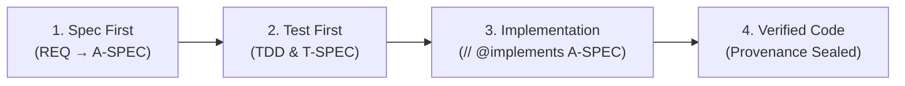

# 🔍 Holmes-Kit

[](https://www.npmjs.com/package/@holmes-lab/holmes-kit)
[](https://nodejs.org)
[](https://github.com/holmes-kit/holmes-kit/blob/main/LICENSE)

> **"No Spec, No Code"** — Deterministic Agentic Software Engineering (ASE) harness with causal traceability.
>
> Its hook prevents accidents. Its resistance to forgery has not been verified: it is not a security boundary against the same user's agent shell.

<!-- holmes-kit:attest:begin -->


**609/609** source files (100%) trace to an approved spec · **1427/1559** approved A-SPECs (91.5%) are anchored from code.
Measured at `3cf425cd7985+dirty` (specs `sha256:7421077ac16f`) — reproduce with `holmes-kit attest --exclude docs/goals/probes/`.
<!-- holmes-kit:attest:end -->

### 0.40.x push evidence: the supported surface

The pre-push gate accepts a full `test_run` as evidence only where holmes can check the run afterwards without changing your runner configuration. Outside that surface the push is refused as `environment`, with one message: "이 구성은 0.40.x가 증빙하지 않습니다 — 0.41 / 오너 결정". General support is planned for 0.41.

**A full run tests the commit, not your work tree.**
- It checks HEAD out as a temporary git worktree **outside the repository**, in `<os tmp>/holmes-headwt-<user>/<repository key>/<id>/`, made with no git hooks and no write to your git configuration. It links your gitignored `node_modules`, runs `ax.config.json` `testRun.prepare` there if you declare one (for example `["npm", "run", "build"]`; nothing is guessed, and a package-manager install is refused because `node_modules` is your work tree's; `[]` or `null` declares none, and any other malformed value ends the run with the reason *(0.41.1)*), runs the suite within the run's time budget, and removes the worktree. The prepare and the tests are told that worktree as `CLAUDE_PROJECT_DIR` *(0.41.1)*.
- holmes removes only a worktree git lists at that exact path, through `git worktree remove`; it never deletes a directory itself and never runs `git worktree prune`. A leftover of a run whose process is gone is removed by the next run.
- Untracked, ignored, modified, assume-unchanged and skip-worktree files never reach the run, so a red commit cannot pass on a green work tree. Nothing is written inside your repository, and nothing has to be added to `.gitignore`.
- **The run must read only HEAD, judged by what it loaded.**
  - A symbolic link anywhere in a linked `node_modules` that resolves into your work tree (a workspace package, at any depth) is `environment`, naming the link.
  - Before any test, the pytest interpreter is started in HEAD's worktree (`python -P`, so 3.11 or later) and asked where every dotted module name of HEAD's python files resolves (every layout and namespace package; capped by `testRun.pythonNames`, default 20000). An import-path entry or a `NODE_PATH` entry inside your work tree is `environment` by itself. A name that resolves into your work tree is `environment`, naming it, whatever the tests later do: subprocesses, xdist workers, a `sys.modules` restore. Typical causes are an editable install, a `.pth` finder or `PYTHONPATH`.
  - pytest also runs with a holmes plugin that records every module it loaded, judged the same way. The exempt locations are the interpreter's own library directories.
  - node is asked the same question for HEAD's package names, `NODE_PATH` included. The `node_modules` walk is bounded by `ax.config.json` `testRun.linkWalk` (`{ "entries": 500000, "seconds": 20 }` by default), and a directory it cannot read is `environment`.
  - Named limits:
    - a HEAD conftest that rewrites the plugin's record (a forgery; the environment question still holds);
    - a package that requires your work tree by absolute path;
    - a legacy sparse checkout (`core.sparseCheckout` in the shared config) keeps the worktree sparse, since turning it off would write your shared git configuration;
    - a JavaScript workspace monorepo whose `node_modules` links into the work tree, and a `NODE_PATH` entry inside the work tree, are refused as `environment`;
    - the environment question imports HEAD's packages to find their submodules, so a package `__init__` runs during it;
    - xdist is judged by the environment question; no xdist run was measured.
  - After upgrading to 0.40.1, run `test_run({ root, full: true })` once at the commit you push: records of 0.40.0 and scoped runs are no longer push evidence. A pytest project needs python 3.11 or later.
  - pytest reads HEAD's own configuration file, pinned with `-c`.
  - `PYTEST_ADDOPTS` and `PYTEST_PLUGINS` are dropped.
  - `GOFLAGS` with `-run` or `-skip` (also `-test.run`, and also set through `go env -w`) is `environment`.
- The pytest interpreter is still the work tree's (a `.venv` is not in HEAD).
- A scoped run stays in the work tree.

| Runner | Evidenced in 0.40.x | Refused as `environment` |
|---|---|---|
| jest | One jest configuration source (the root's, or one directory's) with one project. holmes passes jest no ignore argument. Passed means exit 0 **and** no failure in the report. | `projects`; jest tests at the root beside another directory's configuration, or two configurations; a package.json script that runs jest with `--config`/`-c`; a configured `testNamePattern`; output `--showConfig` cannot print |
| pytest | Default test names (`test_*.py`, `*_test.py`), outside pytest's default norecursedirs. `--rootdir` and `--confcutdir` are the unit, and `--ignore` adds your exclusions. Passed means exit 0 **and** no JUnit failure or error. | a declared `python_files`, `python_functions` or `python_classes`; `-k`/`-m` in `addopts` |
| go | The `_test.go` files `go list` builds on this platform with no tags, per package. Passed means exit 0 **and** no failed test event. Files go does not build here are named in `notBuilt`. | go test files under no `go.mod` |
| cargo, maven/gradle, dotnet | — | a build root holding tests or code; test files of those languages under no build root |
| others | — | a build file 0.40.x has no runner for (Gemfile, composer.json, Package.swift, build.sbt, mix.exs, CMakeLists.txt, pubspec.yaml) |

- **Exclusions** (`.gitignore`, `ax.config.json` `testRun.excludeDirs`, git submodules) differ by runner:
  - pytest takes them as `--ignore`, and go leaves those packages out;
  - jest is told nothing, and the tests it reports under an excluded tree leave the judgement. If such a test ran red, the push is `environment`, naming the file: the runner's own configuration must leave it out too;
  - a git submodule is empty in HEAD's worktree, and named.
- **Code** is tested only by an executed test of the scanned universe whose own nearest build root is the code's. That a unit ran is not evidence, and a test outside the repository credits nothing.
- **A push without evidence** is allowed only when there is nothing to test: no test file and no implementation code.
- **C# (dotnet) scoped verdict:**
  - It needs the JunitXml.TestLogger package; without it the run is `environment`.
  - A C# failure is held as red-error, because the JUnit report does not tell an assertion from an exception.
  - Each planned file must show an executed case. The report keys a C# case by its `file` attribute relative to the run directory, or by class namespace (classname) when it has none, so a namespace that differs from the path reads as not executed.
  - A TRX reader is a follow-up to measure, not a known fix.
- **Named limits:** a red behind a go build tag; a `-k` deselection that is not declared in configuration; a linked `node_modules` that differs from the lockfile.

---

## 🕵️ Philosophy & Vision: Beyond Code Generation

**Holmes-Kit** is not merely an AI code generator. Inspired by **Sherlock Holmes**, Holmes-Kit is built to **deduce, track down, and analyze code defects, structural drift, and security vulnerabilities** across the full Software Development Life Cycle (**SDLC**).

---

### 🛡️ Currently Supported Features (Production Features)
- **Stop judges the branch you are on; push judges every branch** *(new in 0.41.6)*: Stop's spec seam lists only the spec commits HEAD reaches that no recorded tip explains, so a spec commit granted in another worktree, or one on a fetched branch or tag, no longer raises ART-5 here. The push judgement still reads every branch and tag, so such a commit is judged when it leaves. A baseline advances HEAD's tip and keeps the others (at most 256; past that, tips another tip reaches go first). Tips are recorded as commit ids (an annotated tag is peeled).
- **`test_run` says what it recorded** *(new in 0.41.6)*: a full run that is not push evidence (red, stopped at its budget) answers `scopedEvidenceRecorded: false` and `attemptRecorded { judged, reason }` instead of `scopedEvidenceRecorded: true`; what it records and voids is unchanged. A `test_run` given a `head` refuses before it runs or records anything when the work tree differs from that head in a file of the range.
- **`node:test` files run under node's own runner** *(new in 0.41.6)*: `test_run` detects `node:test` files, runs them with `node --test` and judges them by structure, not as jest; the evidence names the runner `node-test`.
- **A principle-7 spec named with Windows separators is a person's seal** *(new in 0.41.6 — gate fix)*: a Files to Touch that writes a gate file as `src\holmes\hooks\stop.ts`, or names `src`, now puts the spec in the category a person seals; before, a full profile could seal it alone. The autonomous principle-7 seal after two clean reviews is built but ships **off** in 0.41.6 (`P7_AUTONOMOUS_SEAL_ENABLED = false`): a hard-link path is still open, so a person seals those specs as before.
- **A deletion naming many absent entries next to wiring is refused** *(new in 0.41.6 — gate fix)*: a deletion judgement reads each parent directory once and looks up at most 512 alias candidates; a command over that budget is refused instead of being judged slowly. A directory that no longer exists counts as absent.
- **Under auto mode, a sealed spec is staged without a person** *(new in 0.41.6)*: with autonomous approval on and no full profile, staging a sealed spec follows the same machine conditions as under a full profile. A spec that changes the owner ceiling or the decision core still goes to a person's form.
- **Nested Windows shells are read, or refused when they cannot be** *(new in 0.41.5 — gate fix, upgrade recommended)*: text handed to `cmd`, PowerShell or `wsl` (`cmd //c`, `start`, stdin, `Start-Process`, `wsl sh -c`) is judged as the shell it runs in, with 8.3 short names and `\\?\` spellings resolved to the protected file they name. What the gate cannot model there — cmd grammar, stdin, a run-time link, a program named by a variable, an interpreter under a program the gate does not read, an unknown copy switch — is refused as unjudgeable, and a shell write to a UNC or device path is refused. The gate is not a sandbox: where execution must be isolated, use the operating system's.
- **Stop finishes inside half of its harness's limit** *(new in 0.41.5)*: the budget is 30 s on Claude Code and Antigravity and 37.5 s on Codex. Judgement always runs; an observability stage that would cross the budget is skipped with a `not judged: budget` warning, and the next Stop runs it first. A cold scan cache is built in the background.
- **The spec seam judges past 200 new commits** *(new in 0.41.5)*: up to 5,000 in one `git log` pass, so a large clone no longer needs a person to re-baseline it. A fresh clone trusts its fetched merge-base, and forging a remote-tracking ref is refused.
- **Autonomous approval friction removed** *(new in 0.41.4 — a loosening, owner directive)*: a person's seal of an A-SPEC opens its principle-7 write window for **48 hours** instead of 12 (`autonomy.sealWindowHours` still only shortens it); `spec_approve` admits a REQ whose server-issued, unspent `triage_evidence` it spends at approval; the spec seam, past 200 new commits, rebaselines when every tip's spec-store tree equals a recorded tip's (`seam rebaselined`); and `spec_unseal` takes an optional `directive` that, under an active full profile, unseals a spec outside principle 7 without a grant, recorded with `full-autonomy:<scope>` as actor. Principle 7, config, secrets and approvals writes, the push and publish flags and spec deletion stay with a person.
- **MCP refusals are observed by their declared outcome** *(new in 0.41.4)*: after every CallTool answer the server appends one line to `.ax/ledger/refusal-observations.<replica>.jsonl` — kind `refusal`, `failure` or `unclassified`, every field from a closed set, no reason text and no path; a success writes nothing and the line never changes the answer. `doctor` prints the uncarried count and the field report gains `refusalObservations` (counts, not a rate).
- **A governed commit without evidence is refused wherever it is pushed from; a project's first push takes a person's single-use grant** *(new in 0.41.4 — re-run `holmes-kit install-push-gate`)*: the pre-push gate judges every pushed line (not only branch refs), a linked worktree by its main checkout's ledger, and asks git what a worktree and its hooks directory are. There is no first-adoption pass: with no ledger anywhere and a remote that has not adopted, the push files a `push-first-adoption` request, and a person's grant for this repository, push URL and commit opens it once, spent before git sends the pack. The hook is defence in depth (`--no-verify` skips it); a remote required check is planned for a later release. NOT MEASURED on Windows; git 2.31 or later is required.
- **A Codex deny is written in the form Codex enforces** *(new in 0.41.4 — gate fix, upgrade recommended for Codex users)*: Codex on Windows launches hooks through PowerShell, which turned the gate's exit 2 into 1, and Codex then ran the denied command without telling the model. A deny for a Codex-shaped call now exits 0 with the deny JSON, in ASCII, as the only line on stdout — the form Codex reads (measured on codex 0.163.0, 0.166.0, 0.168.0 and 0.170.0 on macOS; on Windows a probe hook on codex 0.169.0, one run — the Holmes kernel's Windows field check is pending). Updating the package is enough for a kernel-direct install, with no re-trust. A routed install (hooks dispatched from `~/.holmes/runtime`) on macOS and Linux gets it only after the owner re-runs `holmes-kit runtime-binding setup --workspace <workspace> --package <checkout> --release-package <install>` with this build — `holmes-kit upgrade` does not refresh the router; until then such a router still blocks a Codex deny but turns its reason into "Runtime dispatch refused … retry". On Windows the routed hook command does not start under PowerShell (review reading, not measured): wire the hooks kernel-direct with `holmes-kit init`. **A hook crash passes, and is told to the person (ADR-019):** a crash, or in a governed project a stdin that is not a JSON object, exits 1 on every harness (Antigravity: `ask`), with a stderr line, a best-effort record in `.ax/state/hook-crashes.jsonl` and doctor's `hook crashes` row; a verdict the gate reached is still that verdict. A routed install's dispatcher still denies on a kernel crash until the router is aligned. Still fail-open on Windows Codex: a deny whose stdout write fails or does not finish within 2 s; a call without a Codex shape; the inline path (no worker); a hook crash — by policy on every harness, recorded (ADR-019); a signal or an out-of-memory abort. On macOS and Linux a Codex older than 0.163.0 (0.155-0.162 not measured) may let a denied command run, and `doctor`'s `codex deny enforcement` row FAILs it; codex-cli ≤0.154 is no longer supported.
- **An agent cannot switch off or swap the gate that governs it** *(new in 0.41.3 — gate fix, upgrade recommended; the shell-line rule prevents accidents and is not a security boundary)*:
  - `holmes-kit init`/`upgrade` options that re-wire the gate (`--remove`, `--force`, `--matcher` — `--matcher ".*"` stays free —, `--specs-dir`, `--settings`, `--autonomy`) and re-wiring from another or an older holmes-kit copy need a `governance-wiring` or `config-write` approval. A shell line that runs holmes-kit `init`, `upgrade`, `ledger` or `runtime-binding` in a form the gate cannot read whole is refused (`line.unread`) — write it as a plain line; no approval lifts it. A plain `holmes-kit init` still repairs removed wiring.
  - A package-manager command that removes holmes-kit, names it at a version that is neither latest nor above the governing one (in any command but a read, or in a runner other than a `report` run), swaps or links it, a manifest edit that removes, lowers or swaps its entry, and a shell write to a package.json that names it, are the owner's; an unversioned or `@latest` install and `holmes-kit upgrade` stay free. The reader has a work budget: for most commands, one past it is the owner's rather than judged slowly. This reader is accident prevention, not a security boundary; the CHANGELOG names the forms it does not judge.
  - A write that changes a judgement key of `ax.config.json` — in either direction, by any write that names the file, a hard link included — is the owner's; a write that does not name it (`git apply`, a checkout, a variable, a script) is not judged; lowering `semantic.maxTier` or `autonomy.ceiling` stays free.
  - A hook answer that is not a valid decision is refused in a governed project (the judging worker's own output goes to stderr), and so is a routed gate that died by a signal or gave no valid decision (routed workspaces: run `holmes-kit runtime-binding setup` again). `doctor` and `workspace_preflight` report whether a failed hook lets tools through (doctor: `hook failure posture`; preflight: `hook-failure`).
  - The CHANGELOG's Known limitations name the forms the gate does not read; an after-the-fact integrity check is planned for a later release.
- **A prediction is scored on its own window** *(new in 0.41.3)*: `test_run`'s automatic close attributes to each persisted `maintenance_analyze` only the commits up to the next analysis, and `maintenance_calibration` returns `fileScores` (test files scored apart, the precision ceiling).
- **The gate says what it judges, and run start judges what wiring launches** *(new in 0.40.0)*:
  - **A shell command that builds a path into `.ax` while it runs** is judged by the same not-a-read rule as one that names a protected path. The refusal says how the command was read and what to do first. This rule prevents accidents; its resistance to forgery has not been verified. Replaying 1,000 commands agents really wrote against 0.39's rules on the real hook, two samples gave 1 and 4 newly refused (0.1% and 0.4%). That corpus ran on the Claude Code input shape only.
  - **`run start`** passes `mcp` and `gate` only for what launches holmes-kit's own entries, not for wiring that merely names it (breaking). `--provision` now covers a Codex worktree's MCP table; Antigravity run start is refused until its loading of a linked worktree's `.agents` is measured (breaking).
  - **The operator judgement knows cursor-agent and opencode**, from their published package and source, and a user or project file may add to that catalog. Attestation of the in-session approval form is stricter, and is not strong proof against an agent of the same user.
  - **`approve` decisions take an id, or a prefix of eight or more characters that names one request** (breaking): a list number is refused. The approval queue otherwise keeps its 0.39 behaviour; its redesign is 0.41's.
  - The CHANGELOG's Known limitations name the rest. The hook is not a security boundary against the same user's agent shell.
- **An orchestrator's runs carry their own wiring and review policy** *(new in 0.39.0)*:
  - **`run start --provision`** makes a Claude Code worktree governed. It writes the worktree's `.mcp.json` and `.claude/settings.local.json`, and only where git ignores them. They are pinned to the CLI's own build, no secret is copied, and nothing is left behind when the worktree is removed. In 0.39.0 Codex and Antigravity runs are refused by name; 0.40.0 adds Codex (above).
  - **`--review-rounds <1-20>`** stops a run as `review.unresolved` once its failing independent reviews reach the cap, and names the unresolved findings. **`--strict-review`** also blocks on open important findings, at transitions and at Stop.
  - **`approval_withdraw`** lets a session withdraw a request its own MCP server filed. Another session's request is refused.
  - **A stale MCP server says so.** A running server reports `serverStale` on every tool result once the install it loaded has changed. `workspace_preflight` checks its build, and `doctor` and the session banner name every holmes-kit server that started before the last upgrade.
- **Full autonomy mode — judgments inside the scope end at once** *(new in 0.38.0)*:
  - **Issuing.** `holmes-kit autonomy full --scope <dir>` issues a user-level profile. The person issues it once, in the session's approval form.
  - **Within the owner ceiling** *(0.41.5)*:
    - **The ceiling:** `~/.holmes/owner-ceiling.json` is a file only a person's terminal writes. It names the flags autonomous decisions may reach, with an optional expiry.
    - **When an agent's issue is decided:** when autonomy is on for its workspace and every asked flag is within the ceiling. The decision core `decide()` issues it without a form and records one `autonomous-decision` ledger row. A narrowing of an active profile is decided the same way.
    - **Otherwise:** an issue above the ceiling, or with no ceiling or an expired one, waits for a person as before.
    - **Never decided autonomously:** the ceiling itself, and a spec that changes it.
  - **Not a security boundary against the same user's agent shell.** The hook's goal is to prevent accidents; resistance to forgery has not been verified and is not claimed. A grant the agent itself produced is not told apart from an operator's; the gate refuses only the shell commands whose path into `.ax` it can see in the command text. The root fix, grant files kept where the agent cannot write, is planned as a follow-up in a later release. See the CHANGELOG's Known limitations.
  - **Inside the scope**, a judgment ends at once. Staging a sealed spec and unsealing a spec follow the profile's seal judgement *(0.41.5)*. A spec that changes the owner ceiling or the decision core still goes to a person's form:
    - A seal the grader hands to a person seals as `full-autonomy:`. An un-admitted REQ or an undeclared or unknown grade is refused, and the refusal names its fix.
    - A workspace-local destructive git act, or an `rm -rf` inside the scope, passes after a restorable recovery point is written under `refs/holmes/full/`.
    - Every other act the gate already refuses is refused with a route and never queued: secrets, config, approval or ledger writes (in the forms the gate's text judgement recognises), and a recursive delete outside the scope. Outside spec staging, a headless benchmark run does not wait on a person.
    - **BREAKING: push and publish follow the flags** *(new in 0.40.0)*. A `git push`, an `npm publish` or a forge release write (`gh release create|upload|edit|delete|delete-asset`, `hub release create|edit|delete`, `glab release create|upload|update|delete` *(0.41.3)*) the gate reads in the command's clauses is refused without `--allow-push` or `--allow-publish`, and a grant does not lift it. A help or dry-run form passes, except that a force push with such a flag is still refused while the push flag is off. The gate reads a limited set of command forms; the CHANGELOG's Known limitations name the classes it does not read. A registry write is read where a program takes its subcommand *(0.41)*: `npm publish`, `npm dist-tag add`, a release tool, or a package script that runs one, read from the `package.json` npm would use; the words a program takes as data (`git commit -m "…publish…"`, `gh pr create --body …`, `grep publish`) are never searched. It prevents accidents and does not stop a determined agent — keep two-factor authentication required for publishing on the npm account, and give agents a token without publish rights. Known limits of that reading *(0.41)*: a program the gate's table does not list that runs one of its string arguments as a command; shell functions and aliases; script files a command runs (`./release.sh`, `source`); make variables; words assembled at run time (`npm ${V}lish`); packages inside git-ignored directories; a one-line `case`; `npx -c` or `npm exec -c` behind a wrapper; option variants around `bash -c`; rare wrapper subcommands (`launchctl asuser`, `nix shell -c`); a git alias that pushes without `!`; `foreach` after `git submodule` options; `git subtree push`, `hub push`, `git send-pack`, `git svn dcommit`, `p4 submit`; `script -c` and `flock -c`; `parallel :::`; variable variants (`builtin`/`command` prefixes, `printf -vW`, `${W/a/b}`, CDPATH); `sudo -D` and `--chdir`; contradicting dry-run flag pairs; option-value positions in `git push`; nested git repositories; yarn v1's `publish --dry-run` semantics; a package name after an npm `--no-*` flag that matches a write abbreviation; run valued options outside the gate's table; npm options after `--`; `mise -c`/`--command` and `mise --cd <dir>`; a script run inside an unknown program; wrappers nested nine deep or more; a command of more than 100,000 words; the `.ax` working-directory test harness; the directory where `npm exec -w <ws> -c '…'` runs its `-c` command; a yarn publish option outside the gate's table whose value is read as the folder; valued options after a bare `yarn` outside the table (`--https-proxy`, `--preferred-cache-folder`); a global install whose argument is not literal or is a `file:` spec (`npm i -g "$PWD"`, `$(pwd)`, `file:.`), and `-g --omit dev`; the directory `.` names in `npm i -g --prefix <dir> .`; the aliases `pnpm install-test`/`it`, `pnpm t` and `bun a`. A command too large to judge — more than 400,000 words, a clause of more than 20,000 words, more than 2,000 package directories read, more than eight readings of options the gate does not know, or more than 900 ms — is refused under a full profile whatever its push and publish flags, with its size named and the advice to split it (the longest of 86,000 measured agent commands has 1,553 words). The "more than 100,000 words" limit above is the shell lexer's, where the gate stops reading structure; this budget is the outward judgement's own. Subshell groups nested more than 64 deep are closed the same way, and a refusal lists at most 200 findings and counts the rest. The 1-second bound is the outward judgement's; the hook's whole time on a 1 MB command also includes the other gates (1.3–1.8 s measured). Known limit: in a project that holds no spec file yet, a gate error (a deadline, a crash) lets the command through, so a deadline there does not stop an outward act. In a program it does not know, only standalone words are read (`mytool npm publish` is refused, `claude -p "…npm publish…"` is not). The barrier to an outward act is npm's 2FA and the profile's push flag. With or without the flag, in a repository holding a spec change that no approval staged, the spec-change check refuses a push first, a command that only names a push included; a publish has no such check. Issuing a profile again replaces every flag: one issued with `--no-architecture` returns to approving architecture documents unless the flag is named again.
    - **Not judged.** A plain write outside the scope gets no decision, so REQ-792's criterion that such an act is refused is not met in 0.40.0.
  - **Revoking.** `--revoke` ends the profile.
  - **The agent does not type approval commands.** The agent's refusal tells it to call `approval_ask` with the id. The operator's own screens (the non-TTY hint and the refusal-log footer) still print an `approve --grant <id>` line for a person to paste.
  - **Shell grants** last until they are used.
- **Approvals happen in the session, not in a separate terminal** *(new in 0.37.0 — gate fix, upgrade recommended; the hook prevents accidents and is not a security boundary)*: a refusal now ends with `Agent: call approval_ask with id "req-…"`. The MCP tool `approval_ask` shows that request in the harness's approval form, and the person's answer is recorded exactly as `holmes-kit approve` records it. That covers shell, config and code-write approvals (on Claude Code today; Codex and Antigravity are a named gap until measured) and a request a run awaits. `review_verdict` records an independent review verdict the same way. The form waits for the person (no 240-second limit). `approve --grant`, `--watch` and `autonomy on` refuse from a process they judge to be an agent's, the session's `!` included, within the limits the CHANGELOG names: through 0.36.1 an agent could approve its own refused command by running the command its refusal printed. A grant the agent itself produced is not told apart from an operator's either.
- **An orchestrator can run governed agents, and reviews become gates** *(new in 0.36.0)*: `holmes-kit run start --worktree <dir> --engine claude|codex|agy [--scope <A-SPEC>]…` opens a run that pins the CLI, MCP and hook builds, prints the headless command and a stop key, and ends only with that key (`run status`, `run transition`, `run stop`). Inside a run a judgement that cannot be made refuses, within what the gate reads from a command's text: agent launches it recognises are refused, refusals are logged with a repeat stop, an approval pauses the run until the operator decides it, a declared stage machine (analysis → design → implement → review → test → done) denies the writes it recognises per stage, and Stop and push wait for an independent passing review. `holmes-kit review record|status|gate|mrp` records verdicts bound to a commit range, refuses self-review (an agent-harness ancestor process included), and assembles the merge-ready package. Every deny ends with a `[holmes-refusal]` line carrying a stable code. A project can cap its semantic tier (`semantic.maxTier`) and its automatic approval (`autonomy.ceiling`) in `ax.config.json`, and only an approval can raise either. doctor counts cloud embedding requests. `approve --withdraw` lets a run close its own request. Interactive sessions keep 0.35.25 verdicts, except for what this release adds to the gate's reading: path-less spec staging, computed shell writes, executable files and side paths under a role policy, and Claude Code's PowerShell tool on Windows. Interactive agent launches may carry the autonomy options measured to keep the child's Holmes gate. This is an interim release of the role/phase goal: the acceptance scenario with a reference orchestrator has not been run yet.

- **Agents clean up their own temporary work** *(new in 0.35.25)*: `holmes-kit scratch --new <label>` makes a directory under a per-user Holmes scratch root (`os.tmpdir()/holmes-scratch-<uid>`, mode 0700), and on macOS and Linux the gate lets an agent in Claude Code, Codex or Antigravity remove it with one plain `rm -rf <absolute path>` without an operator act; the root itself, tracked source, every other path and any compound command keep their verdict. Where another holmes-kit install sits in an ancestor `node_modules` of the workspace or the home directory (npm, Windows shims and pnpm alike), approval hints name the running install's own path so that copy cannot answer them (a PowerShell form on Windows), and doctor's `npx resolution` row names it.
- **You can tell whether a harness's gate actually ran here** *(new in 0.35.24)*: the PreToolUse and Stop hooks of Claude Code, Codex and Antigravity leave a git-ignored per-harness record (`.ax/state/hook-heartbeat/`, at most one write a minute, never part of a decision). `workspace_preflight` with `harness` passes `runtime-enforcement` only after that harness's PreToolUse gate was observed within 24 h and since its wiring last changed; doctor shows one `hook observed (<harness>)` row each; `runtime-binding status` reports `activation` for this selection's gate and names every other observation and an outdated deployed dispatcher. `runtime_binding` answers an unbound workspace with its routing instead of "not registered", init states a Codex verdict for registry-owned Codex files, and doctor FAILs a running Stop hook under 75 s. Measured need: a Codex session in a release-routed workspace concluded it was ungoverned.
- **A benchmark run the operator pre-approved finishes with zero human waits — the run delegation** *(new in 0.35.19)*: `holmes-kit autonomy delegate --run <id> --allow <rule[,rule]> [--for 2h] [--limit k=v]… [--rationale <text>]` (same human proof as `autonomy on`) writes a run-scoped, workspace-bound (realpath), expiring delegation that covers a closed set of autonomy-grader rules — root-only or gate-file Files to Touch, an undirected gate-behavior grade, an upstream without A-SPEC; never architecture documents, un-admitted requirements, undeclared or unknown grades. A hitl spec whose only reason is a covered rule seals on its own with `source: 'delegated'` and a ledger row naming the run and the rule; an uncovered case refuses with the named limit (`does not cover`, `expired`, `for <workspace>, not this root`, `invalid document`). `autonomy status`, `approve --status` and the session-start banner show it; `revoke-delegation` or `off` ends it. The host's own approval layer is named as not covered. Measured need: X1 (2026-10-12) stopped a pre-approved fixture on `files-to-touch-root-only`. Every operator hint now also names the workspace (`--target <root>`), a context-only Codex patch is refused as a no-op by name, and `runtime-binding status`/`doctor` report a Codex lifecycle routed to Holmes from both the user-level and the workspace hooks file.
- **Each release carries its own summary** *(new in 0.41.2)*: `release-history.json` at the package root holds a short Korean and English summary of each release from 0.40.0 on (benefits, upgrade conditions, limitations), which the Holmes Lab website reads from the exact published version. The release gate refuses a publish without a valid entry for its own version.
- **The ledger has a witness the tree cannot move** *(new in 0.41)*: in Holmes-Kit's own repository (and for a package that is not npm-installed), the gate reads its provenance chain only when the chain is the one this repository wrote — a witness in the git directory, moved by every append, says so. A chain taken back by a checkout or a stash, or extended by rows brought in from outside, closes the judgement until the tree returns or a person vouches (`holmes-kit ledger witness`). A new checkout starts closed until a person vouches once.
- **The gate and approval-processing source is sealed by a person** *(new in 0.41)*: a spec whose Files to Touch names a module that reads or writes a grant, an actor, a seal or a decision (the hooks, guardrail and governance code, the approval CLI and MCP handlers, review verdicts, runtime dispatch, the spec transition policy) is sealed only by a person — no declared grade, run delegation or full profile seals it; a census test keeps the category whole. Such a file is also *written* only within 12 hours (`autonomy.sealWindowHours`, 1–24) of a person's seal of an approved A-SPEC whose Files to Touch names it — in the session form (or a host's approval dialog); a seal spent from a grant file does not count, since a file write can make one — and each write a window opens is recorded in the ledger; an anchor already in the file, or an older seal, opens nothing. Whatever wrote it, a gate-file change since the live gate's baseline (the commit the gate last built, recorded in the ledger) — in the working tree, the index or a commit — that no window names blocks the turn's end, a commit and a build. It stays blocked until a person seals a spec naming it, a branch switch or pull that brought it is undone, or the file is made equal to the baseline again; a commit made outside the gate (an owner's terminal commit, a pull) is judged the same way, and the refusal warns first that a restore from the baseline also discards such commits (Holmes-Kit's own repository; it prevents accidents, forgery resistance is not verified). A local-only wiring file (skip-worktree or assume-unchanged), changed only in the working tree, whose bytes are exactly what the runtime binding receipt recorded is not an unopened file *(0.41.3)*.
- **Un-seal and retire are decisions of their own** *(new in 0.41)*: `spec-unseal` and `spec-retire` are approval kinds of their own (a seal's approval does not cover them), every path names a transition's kind from one table, and a seal records the MCP server instance that made it.
- **An autonomy profile is issued only through its own request** *(new in 0.41)*: a command that sets an out-of-band approval itself before `holmes-kit autonomy full|on|delegate` is refused as `profile.own-request` and files nothing; the request the plain command files names the flags it changes.
- **Sealed specs are staged without a person** *(new in 0.41)*: under a full profile, staging a spec whose seal holds, whose parents are sealed and pinned, which sits where its type and id say, and whose Files to Touch stay outside the gate category is approved by the gate itself (R1). From 0.41.5, staging follows the profile's seal judgement: when the profile may seal the spec, no form is asked. A spec that changes the owner ceiling or the decision core, a draft, or a broken chain still goes to the person's form. Under autonomous approval without a full profile, staging still goes to the form; autonomous staging there is planned for 0.41.6. `autonomy.specStaging: "off"` restores the form for all.
- **A request no one can follow up closes by itself** *(new in 0.41)*: a request filed by a hook or the CLI (no requester run or server), not held, and not decided within 24 hours is closed unrun at the next session start (`closed-expired`, actor `policy:ttl`) — counted from the first filing of a decision-inbox request (its repeats are not recorded) and from the last refusal of a refusal-log request. Nothing runs, it is not a denial, and asking again files it anew; a person's decision after that is recorded and stands. The session banner counts the closures.
- **A refusal you cannot see in the inbox is still answerable from its own hint** *(new in 0.35.18)*: six repairs measured in a Codex X1 runtime session and a field report. Every refusal line written to the refusal log ends with `run: holmes-kit approve --grant <id> --target <root>` carrying the actual id, the inbox (`approve --list` / `--watch`) prints a footer counting requests outside the inbox, and the `--refusals` closing line spells the same command (the positional `approve <id>` the first repair wrote is refused by the CLI, so it was measured and rewritten). An autonomy refusal on a parent spec names the child rule that forces the human decision (`upstream-has-human-aspec: <id> — <rule>`). A runtime deadline refusal ends with the per-phase millisecond split, and the Stop hook prints how much of its 18 s budget it used once it passes half. `runtime-binding status` separates `drift` (operator-config / stale-workspace) from `conflicts` and reports whether the router is intact. The `--autonomy` usage, the `init` refusal and the interactive prompt now say the same thing.
- **An agent is told what to do after an approval, and a patch is judged the way the tool applies it** *(new in 0.35.17)*: five repairs measured on a Codex worker in a SWE-bench comparison. `approval_status` now carries `request { id, state, question?, reason?, ts? }` (pending / held / granted / consumed / denied / revoked, read from the approval queue, with the operator's LATEST hold question) and one `nextAction` sentence — a sealed spec says "stop polling", a held request relays the question; the pending-approval hint ends with an `Agent:` line beside the unchanged operator lines. `test_run` reports `anchorDiagnostics` for an `@implements` list joined by `;`, `|`, `&`, `/` or `and` (the comma grammar does not read them; attribution is unchanged, the omission is named). A Codex `apply_patch` update is applied chunk by chunk from the previous chunk's position, as the tool does, so a context line that recurs earlier in the file no longer makes it "unreadable", and a patch that does not apply is refused by a sentence naming the file and the chunk. A quoted or escaped glob (`rg ".*"`) is no longer read as a spelling of the `.ax` store (an unquoted `.*` still is). The background refresh child records `failure { stage, reason }` on its freshness receipt instead of failing silently.
- **The analysis names the unchanged files a change has broken** *(new in 0.35.16)*: with `changedFiles` given, `maintenance_analyze` reports under `impacts.removedNameUsers` every unchanged file that imports a changed file and still uses a top-level name that file no longer defines (removed or renamed), and the files still importing a deleted TypeScript/JavaScript file. Deterministic and read-only; TypeScript/JavaScript and Python. Measured on public repositories: every file named was one the commit did change (22 of 22, 21 of 21). It fires rarely — 2–7% of the files an incomplete change set was missing. Member names and changed signatures are not read.
- **The analysis names the file a change still has to create** *(new in 0.35.15)*: with `changedFiles` given, `maintenance_analyze` reports under `impacts.missingNewFiles` every relative import a changed TypeScript/JavaScript file newly introduces that resolves to nothing — the importing file, the specifier and the candidate paths. Deterministic and read-only. On two unseen windows of a public TypeScript monorepo every naming was a file the change did create (precision 1.000), covering 78–86% of the not-yet-existing files an incomplete change set was missing. Only uncommitted changes in a git repository; other languages, bare package names and path aliases are not read.
- **ES-module TypeScript projects get their import graph** *(new in 0.35.14 — fix)*: a specifier written `./x.js` for a `x.ts` source (the ESM convention) now resolves, where it used to emit no edge at all — on a public TypeScript monorepo the graph went from 3 import edges to 4,628 of 6,854 import relations. Extensionless projects are unchanged. The cycle ratchet sees the same edges. Workspace package names are still unresolved, and the graded impact list does not yet use import edges.
- **The impact list also knows where work is concentrating, and a release is refused when its badge has not moved since the last tag** *(new in 0.35.13)*: for a named change, `impacts.rankedImpact` is fused once more with each file's recency-weighted change frequency (same single `git log`; rows may carry `changeFrequency`). On 703 replayed changes neither corpus had been measured on before, recall among the ten rose 0.485 → 0.545 and 0.378 → 0.540 on a second, Python repository (both above the minimum detectable effect) and 0.521 → 0.551 / 0.419 → 0.477 here; precision rose detectably on all four windows. Stated plainly: against the modelled human engineer this project aims at (`docs/NORTH-STAR.md` — recall 0.67–0.78, precision ≈ 0.9) recall is still below the band and precision about a sixth. Separately, `npm publish` now refuses when the README shows the attest badge and `.ax/badges/traced.svg` was not re-measured since the previous release.
- **What else moves when you change this file — ranked by history too** *(new in 0.35.12)*: when `maintenance_analyze` is given `changedFiles`, its graded impact list (`impacts.rankedImpact`) fuses the call-graph ranking with recency-weighted co-change from git history (files committed together with the changed ones, recent commits counting more). On replayed changes of a second, Python repository a file that really changed with the named one is among the ten shown with recall 0.44 instead of 0.34 (beyond the minimum detectable difference, and replicated on further changes); on this repository the difference is positive and not detectable. Walking the call graph deeper was measured at the same time and not adopted: it reaches more and ranks worse.
- **The graph states what the code does, and intake answers in one call** *(new in 0.35.11)*: three corrections to what the traceability graph and `requirement_triage` say, each measured before it was built. `requirement_triage` ranked every requirement lineage on the first 64 distinct words of its text; it now reads the whole text (right lineage in the top five: 0.28 → 0.66 on this repository, 0.76 → 0.85 on a second one, both beyond the minimum detectable difference). A call with `persist: true` waits up to 20 seconds for the refresh it requested instead of returning `ambiguous` and asking to be repeated (`HOLMES_TRIAGE_WAIT_MS` sets the bound, 0 turns it off). `maintenance_analyze` lists `relevantTests` in relevance order — tests named after the changed file first — so the ten a bounded response shows are no longer the alphabetically first ten (a test the change also touched is among them with recall 0.48 instead of 0.21 here). TypeScript `calls` edges are bound by the compiler's symbol resolution — 21% of the name-bound edges linked a standard-library call such as `xs.map()` to an unrelated symbol — using only the files the scan already read plus TypeScript's bundled library; and an `@implements` anchor written in or directly above a function links the spec to that function instead of to every function of the file. **What is not claimed:** on replayed changes neither graph correction moved what `maintenance_analyze` returns beyond the minimum detectable difference; they change what the graph states, and the CHANGELOG records one measured cost.
- **The protected store's spelling is recognised in a shell command's text** *(new in 0.35.2 — gate fix, upgrade recommended; the hook prevents accidents and is not a security boundary)*: through 0.35.1 a path into `.ax/specs`, `.ax/ledger`, `.ax/approvals` or `.ax/state` written directly after a shell expansion, a variable, or a character the shell removes at run time was not seen as protected, so a removal, move or overwrite of governance state could pass the gate. The store spelling now counts wherever it appears in a command, and an output redirect to a computed target is not a read. Reads still pass. A directory that merely ends in `.ax` and has a child named like the store's is judged as the store. Limit: a path assembled so the spelling never appears in the command text is outside this rule.
- **The session-start banner in Codex** *(new in 0.35.8)*: with a runtime registry, `runtime-binding setup --activate-hooks codex` (or the `runtime_binding` tool) adds a SessionStart entry to the workspace's `.codex/hooks.json`, so a Codex session starts by being told which Holmes build governs it and whether autonomous approval is on — as Claude Code sessions are. It runs after you trust it in Codex's `/hooks`. Antigravity passes no hook output to the model, so nothing is wired there.
- **The Stop hook leaves other repositories alone** *(new in 0.35.7 — upgrade recommended for Codex users)*: Codex wires the Holmes Stop hook at user level, so it is called in every repository on the machine. Through 0.35.6 it blocked the end of a turn in a repository that is not a Holmes project (`[ART-1] … no @implements anchor`). It now answers nothing where no project can be found; inside a project nothing changes.
- **Re-apply a registered runtime binding without leaving the session** *(new in 0.35.6)*: the MCP tool `runtime_binding` previews and applies the plan `runtime-binding setup` would make for the registered workspace, including `activate_hooks`. It never chooses a build — it uses the package the operator registry already names — and it writes only when you answer approve in the approval dialog, which shows the plan digest and the files. No answer, a denial, a client without the dialog, or autonomous approval write nothing and leave the usual queue request. Native hook trust in Codex is still given in Codex's `/hooks`.
- **`doctor` shows when a checkout's hooks are not the ones its sessions run** *(new in 0.35.5)*: when you develop Holmes-Kit itself with sessions routed to a released install, the `development hooks` row compares the compiled files and has both hook programs judge the same payloads, so a hook change that is not live yet is visible instead of assumed. In the same release, `runtime-binding setup` refuses a plan that would write the Codex gate where Codex has it switched off *(gate fix; the hook prevents accidents and is not a security boundary — if you ran setup with 0.35.2–0.35.4, check `doctor` for `FAIL codex user hooks`)*.
- **No in-session shortcut around a person while autonomy is on** *(new in 0.35.4 — gate fix, upgrade recommended; the hook prevents accidents and is not a security boundary)*: on a client without the MCP form dialog, the `approval_commit` continuation is no longer offered or accepted while autonomous approval is on — the request goes to the approval queue. Its only human check is the host's own tool confirmation, which an allow rule or auto mode removes. With autonomy off it works as before; seals made through it are recorded as `host-gated:<harness>`.
- **An unanswered approval is held, never approved** *(new in 0.35.3 — gate fix, upgrade recommended; the hook prevents accidents and is not a security boundary)*: with autonomous approval on, an in-session approval dialog that ran out of time used to be recorded as an approval (actor `autonomous-timeout:<harness>`) — for exactly the seals and critical-finding resolutions autonomy reserves for a person. An unanswered dialog now returns the request to the approval queue in every mode. To audit earlier sessions, search the provenance ledger for `autonomous-timeout`.
- **Approvals that fit how people work** *(new in 0.35.2)*: an approval for a request that carries the approved content's digest (a spec seal) no longer expires after 30 minutes — it stays valid until used, revoked, or the content changes (`--ttl` still bounds it; requests without a digest keep the default). With autonomous approval on, a gate change declared `gate-behavior: tightens — …` or `gate-behavior: wording — …` is sealed without the operator; any other gate change still asks, and a seal handed to the operator says which rule handed it over. On a machine with a runtime registry the in-session approval dialog is reachable again, and `init`/`upgrade` no longer replace wiring the registry owns.
- **Separate development and consumer runtimes** *(new in 0.35.0)*: `runtime-binding setup` explicitly registers a checkout and its built package in an operator-owned registry. Normal Claude, Codex and Antigravity launches select that development package for the registered workspace; other workspaces select the configured release. Missing or conflicting bindings refuse with diagnosis instead of silently switching builds. Setup previews exact changes and requires authority for a changed installation; a validated unchanged plan needs no new grant. Normal migration preserves disabled hooks and native trust. `--activate-hooks` explicitly restores selected Holmes entries, while native trust and global disable switches still require native review. See [development runtime setup and recovery](docs/install-guide.md#development-and-consumer-runtime-binding) for the workflow and current approval limitation. Configuration readiness does not prove live three-harness enforcement.
- **Bounded routed-hook recovery** *(new in 0.35.0)*: routed hooks share an 18-second input/selection/execution budget and allow up to 8 seconds for owned-process cleanup. Failure reports the selected runtime and diagnosis commands, retains unresolved findings, and directs an approved repair followed by retry of the original operation. Cleanup uncertainty is reported; persistent MCP sessions have no hook lifetime deadline. Literal recovery prompts and recognized installer previews are distinguished from actual shell writes without permitting command substitutions or protected output targets.
- **Maintenance evidence survives the RED commit, and test evidence records what ran** *(new in 0.35.0)*: persisted `maintenance_analyze` evidence includes the request and explicit `changedFiles`, allowing the pre-edit advisory to cover named new files and analyses up to 20 ancestor commits back when every intervening change is covered. A passing `test_run` records the tree captured before execution, so edits made during a run remain unverified changes. The static test counter handles literals and same-file aliases, and recognizes suite skips only in code. The shared shell gate accepts read-only loops, prose literals, and commit messages mentioning `.ax`, and classifies file redirects using `>&` and `>|` as protected writes where applicable.
- 📖 **Reading `.ax` from the shell is a read, and a docs fix does not re-run the whole release suite** *(new in 0.34.0)*: the gate splits shell commands at operators outside quotes and substitutions, judges every command substitution it would run, and knows literal `cd`, `pwd`, `sleep`, `seq`, `pgrep`, clock-reading `date`, `git -C` and `while`/`until` loops — so `grep "a\|b" .ax/…`, `f=$(find .ax/specs …)` or `until grep -q … .ax/…; do sleep 20; done` no longer file an approval request, while the write forms the gate recognises are still refused (and `echo "$(sh -c …)"` now is). `sed -i` is judged by the files it edits, not by the words in its script. After a full release lane, `node scripts/verify-release.js --inherit-release-test-lane` lets a commit that changes only `README.md` or unshipped `docs/` files publish on the full lane's receipt by running just the docs tests; the publish check recomputes that diff with git. `requirement_triage` counts a lineage with sub-slices as approved, and an autoreload MCP launcher exits when its client goes away.
- 🗜️ **Large answers are compressed, not cut, and new requirements are not blocked by a guess** *(new in 0.33.0)*: `spec_list`, `review_status` and `reverse_scan` answer by default with a compressed view — duplicates removed, digests dropped, what needs action first, anything left out counted with a note — and `detail: "full"` (or paging, or `spec_list({ ids })` for one spec) gives the complete answer. `requirement_triage` confirms a lineage only when both of its channels agree and the lineage mentions every code identifier the request names, so a requirement next to a finished one, or on an install without a semantic layer, can still be admitted. `maintenance_analyze` judges a Korean or Japanese request against unreadable files by its words and, on the cloud tier, by meaning; the pre-edit gate finds the analysis the session persisted; `spec_approve` names a spec's blockers instead of queueing an approval nobody could use; and `holmes-kit autonomy status`/`off` read the project default in `.mcp.json`, so `off` never claims OFF while autonomous approval is still on.
- 🔎 **The analysis tools decide on evidence about the request, and say what they could not decide** *(new in 0.32.0)*: measured on two repositories by point-in-time replay, `maintenance_analyze` had answered `ambiguous` for every request because a shell script anywhere in the tree counted against it — the classification now counts an unreadable language only when the change touches it, while the test scope stays as conservative as before (relaxing it too let narrowed scopes miss the commit's own tests). `confidence` carries `confidenceCalibrated: false`; persisted evidence records why a scope was `full` and `maintenance_calibration` reports how often each cause occurred; candidate specs come in relevance order. `requirement_triage` answers in summaries by default (`detail: "full"` for document text), counts semantic coverage over documents that can have a vector, and gives `existing-change`/`fulfilled` only when its lexical and semantic channels agree on the first-ranked lineage — a lineage the request cites is listed first but a citation is not evidence — otherwise `ambiguous`, which leaves a new requirement possible.
- 🚦 **The gate only ever denies** *(changed in 0.31.0)*: an action Holmes does not deny is left to your harness's own permission flow — Claude Code and Codex get no permission decision, Antigravity gets `ask` (or `allow` for a read inside the workspace that git does not ignore). Earlier versions answered `allow`, which Claude Code treats as "bypassing permission prompt", so anything the shell model missed ran unconfirmed. In Claude Code's default mode you now see its confirmations again, as without Holmes.
- 🪝 **The Codex gate loads again on codex-cli 0.155** *(new in 0.31.0)*: plugin hooks were removed upstream, so `init --agent codex` wires the Holmes PreToolUse and Stop kernels into the user-level `$CODEX_HOME/hooks.json`, keeps every hook it does not own, and `--remove` takes away only its own groups. Codex runs a user hook only after you trust it once with `/hooks`; Holmes never forges that trust, and `doctor` says so instead of claiming enforcement.
- 🧭 **The shell gate judges by identity, from where the command really runs** *(new in 0.31.0)*: wiring files and the `.ax` store are judged as shell WORDS in the command's text, resolved against each segment's real base — a `cd` moves the base only when it is certain to have run, an uncertain or expanded one (`cd .a?`, a link made in the same command, `cd "$X"`) leaves it unknown and the command is judged at every base it could have produced, and the base starts at the harness's own working directory (the payload `cwd`, a Codex `workdir`), not the project root. An evaluation runs under a deadline that refuses when it passes. The Codex oracle asks the installed Codex whether your config loads — locally, over copies, with plugins and every proxy closed, `sqlite_home`/`analytics`/`otel` isolated from the user copy alone, and a verdict it could not obtain labelled `approximate`. Source walkers skip nested git working trees only when git says the tree is not the project's, read regular files only, and ask git once per scan; the gate-path readers that release measured read linearly in their input.
- 🪟 **Approval stays inside the agent session** *(new in 0.29.0)*: Claude Code, Codex, and Antigravity use the same capability-negotiated route. Holmes opens a direct MCP form only when that live client advertises `elicitation.form`; otherwise it exposes one sensitive, challenge-bound `approval_commit` continuation in the same agent session *(not while autonomous approval is on, since 0.35.4 — the request is queued instead)*. The host may render its native tool confirmation, but its arrival is recorded as `host-gated`, never claimed as proof that a human answered. The server issues an opaque, memory-only intent bound to the action kind, target, subject digest, workspace and MCP run; only one matching retry can consume it. No `config.toml` value or persisted `HOLMES_APPROVAL` is authority. The `holmes-kit approve` TUI is recovery-only when a session cannot present approval. Under autonomous mode, eligible low-risk work stays automatic and an ordinary unclassified HITL request queues without interrupting the agent; high-risk or irreversible work is shown in the session and waits for an answer. Timeout, cancel, deny, malformed and unavailable outcomes never approve *(timeout: since 0.35.3)*.
- 🧾 **A new prompt is checked against governed intent before it becomes a new spec** *(new in 0.29.0)*: `requirement_triage` reads the approved REQ/H-SPEC/A-SPEC/T-SPEC lineage, a receipt-bound current RTM graph, source and requirement-document semantic coverage, code anchors, and exact-HEAD execution evidence before recommending `fulfilled`, `existing-change`, `new`, or `ambiguous`. BM25 is always present; a verified local BGE-M3 cache and explicit Gemini opt-in add candidates and also enter the ranking score, so when lexical evidence is weak or tied a semantic match can decide which lineage leads — every such answer shows its semantic coverage, and a run that used no semantic score says `lexicalOnly: true`. A cold, stale, unreadable, failed, partial, or absent lane remains visible as ambiguity; a workspace with no semantic tier, or with transfer switched off by `HOLMES_NO_SEMANTIC_WARM`, runs **lexical-only** — it can still author a new REQ, and the answer and its evidence say `lexicalOnly: true` (set it in the environment of both your harness — its hooks spawn the background refresh — and the Holmes MCP server; a refresh recorded as suppressed also keeps triage from embedding. The switch stops automatic transfer: the background refresh embeds neither source nor requirement documents, and `requirement_triage` does not embed the prompt; tools you invoke explicitly under an opted-in cloud tier — `maintenance_analyze`, `issue_localize`, `rtm_reindex` — still embed their query or index as before). The detached refresh worker warms both versioned semantic populations under existing cloud-consent rules; a persisted v2 artifact binds prompt, workspace, HEAD, and receipt generation. New REQ creation — through `spec_create` or `spec_slice_init` — verifies that evidence at one shared MCP boundary, whichever harness calls it. A file an agent's own shell writes does not pass through that boundary.
- 🧭 **One governed operating contract survives every harness** *(new in 0.28.0)*: the common managed block in `AGENTS.md` carries the same No Spec, No Code rules to Claude Code, Codex CLI, and Antigravity while leaving the repository's own rules outside the block intact. `holmes-kit guidance check` names a stale or locally conflicted managed block, `guidance refresh` first plans the change and then replaces only the Holmes-owned region, and `doctor` runs the same check. An installer or upgrader cannot silently discard local guidance.
- 🧷 **A worktree can prove which workspace the MCP server serves before an edit** *(new in 0.28.0)*: `workspace_preflight` returns the bound root/store identity and reports a foreign caller as a mismatch without registering, rebinding, or writing anything. `holmes-kit doctor --agent claude|codex|antigravity` checks each harness's local wiring prerequisites and states that preparation is not evidence of live hook enforcement. This is paired with a packaged Superpowers compatibility playbook that preserves Holmes specifications, RED/GREEN evidence, review closure, and finish/reconciliation requirements through the corresponding Superpowers workflow. Fixture and subprocess coverage preserve neighboring configuration and foreign-root isolation; live linked-worktree and paid-harness acceptance remain explicitly unverified until observed.
- 📏 **Say how much of the repository is governed — as a number, not a label** *(new in 0.27.0)*: `holmes-kit attest` reports how many scanned source files are anchored to an **approved** spec, beside how many approved A-SPECs are anchored from code, and says where that is true (commit, plus a digest of the approved specs) so anyone can reproduce it. No new judgement: the scanner's files, the anchors, the existing link census. A per-file "generated under holmes-kit" header was declined — it is a claim that survives an ungoverned edit, and line 1 already carries the anchor a gate verifies. `--exclude a,b` names vendored trees at a path boundary and is echoed in every output; what cannot be measured is `n/a`, never `0%`; `100` appears only when every file is traced. `--badge` writes a self-contained local SVG, and `--readme` rewrites **only** the region between the `holmes-kit:attest` markers — a README without them is never touched, and a half marker is refused. A statement, not a gate: the numbers never change the exit code.
- 🤝 **The collision plan runs under one approval** *(new in 0.26.2)*: 0.26.1 saw a spec number another machine took and printed the plan; carrying it out was still one `spec_renumber` call per family, and that tool's apply asks for no approval although it rewrites approved documents and source anchors. `spec_reconcile` `plan` is read-only and returns the moves, what each rewrites, the re-seal order, the prose it will **not** touch, and a `target` derived from the plan's content alone. `apply` rebuilds the plan inside the store hold, refuses `plan-changed` if a fetch moved it since you looked, demands one `config-write` approval bound to that `target`, and runs every move through the path `spec_renumber` already uses. Forged `moves` are never read — what runs is the recomputed plan. It never seals: `spec_approve` stays the only sealer. No remote is an answer, not a refusal.
- 🔢 **A spec number another machine took is seen before the merge** *(new in 0.26.1)*: two checkouts allocated `REQ-694` thirteen minutes apart, neither could see the other, and it surfaced only as an add/add conflict after the push was refused — a rebuilt slice and five out-of-band approvals. `doctor --target` now reads each remote-tracking ref **as last fetched** (no network) and judges only the documents each side *added* since they parted, so a spec one side merely edited is divergence, not an alarm. On a collision the advice is the plan: `Before merging — move 901 → 903: spec_renumber(oldBase=901, newBase=903); then re-seal`. The side that moves is the one not published yet, the destination is free on both sides, and "published" means equal content — never path, because a spec's path is its number.
- 🔁 **The cycle ratchet finally speaks — and takes a named exception** *(new in 0.26.1)*: since the commit that introduced it, the Stop hook computed the code cycles and called the verdict without them, so the `ART-2` line had never been printed; every unit test passed because each handed the evidence in directly. It is emitted now, bounded (five cycles, five members each, the rest counted — one vendored cycle here has 46 members), and `ax.config.json` gains `architecture.cycleIgnore`: prefixes for trees that are not yours to fix. A cycle is excepted only when every member lies under one, `reference` does not pardon `reference-impl/`, a broken config excepts nothing, and excepted cycles stay counted in the ledger.
- 🧬 **Declare your architecture, in every language the graph can follow** *(new in 0.26.0)*: a C-SPEC's `## Forbidden Edges` takes a third rule kind beside `import` and `call` — `- inherits src/app -x-> ConcreteBase`, an exact match enforced at the pre-edit gate. Nothing is inferred: the rule reads the graph's `inherits` edges and never asks which class is "abstract", which is what makes it hold in Go, where interface satisfaction cannot be inferred at all. A project that already breaks the rule it wants adopts it with a **baseline that expires** — `- allow until 2026-09-27 : inherits src/legacy/a.ts -> LegacyBase`, exact on kind, file and target, never a prefix. Past its date the allowance still holds, because an expiry that blocked would turn the rule into a barrier to adoption; it is **reported** instead, carrying `(reconfirmed n since <date>)` so a twelfth renewal cannot hide.
- 🏛️ **The architecture verdict reaches the person closing the turn** *(new in 0.26.0)*: the scan-wide judgement existed and nothing in the product called it — measured, zero consumers outside the tests — so an expired baseline was neither blocked nor seen, and a time-boxed allowance could not be told from a permanent pardon. The Stop hook now prints `ARCH` lines on the non-blocking `tracked` channel: violations no baseline covers, expired baselines with their renewal count, and **which rule kind could not be judged in which extension** (`inherits rules NOT judged in: .js, .py, .tsx`) — asked per kind, over the files a rule of that kind actually judges, because a pooled answer called a language *judged* for a rule it could not see. No rule declared, nothing said and nothing paid: the judgement shares the one scan the cycle ratchet already makes (measured here: scan 6.6 s, judgement 0.14 s).
- ♻️ **The cycle ratchet judges every language it can resolve** *(new in 0.26.0)*: the Stop hook had re-implemented import resolution beside the graph builder's — relative specifiers only, four extensions. Measured on fixtures shaped the way each language requires: 16 import edges, 2 survived; 9 planted cycles, 1 found. It cost nothing in an all-TypeScript tree (919 edges either way), which is how it survived to 0.25, and everything in a Java, Go, Python or Rust consumer. There is now **one** resolver, consumed by both; a language whose specifiers do not resolve stays `unavailable` rather than reading as clean, and a wide Go package cycle is capped per cycle with the dropped members counted.
- 🔑 **The id a refusal prints can be granted** *(new in 0.26.0)*: `approve --grant <id>` resolved references against the decision inbox alone, and a shell hard-HITL refusal lives in the per-machine refusal log — so the very id the refusal printed failed before the fallback that handles it could run, and the owner had nothing to approve. Id and prefix references now resolve across both stores. A list **number** is no longer accepted for a decision (0.40.0: it names whatever row holds it when the command runs), a prefix that collides across the stores is refused by name, an unreadable log removes candidates rather than granting, and the inbox list is unchanged.
- 📬 **A reporter hears that their defect was fixed** *(new in 0.26.0)*: a defect filed through `holmes-kit report` is matched — locally, once — against the list of resolved reports that ships in the package, and the session start says so. Nothing is sent anywhere.
- 🔦 **A semantic layer that is inert says so** *(new in 0.25.0)*: the tier line said what was CONFIGURED, never whether one lookup would succeed. Measured on this repository: the resolved tier was `cloud` and **0 of 602 scanned files** had a cached document vector under it, so every lookup returned nothing — reranking reordered nothing, alternates emitted nothing, and the output was byte-identical to a layer that examined everything and agreed. A naive check would have counted the 532 vectors sitting in the cache and called it healthy; they keyed on symbol lists that no longer existed. `doctor` now reports coverage against the files scanned NOW, through the runtime's own accessor, in four states — the two that cannot be judged say so rather than passing quietly.
- 🔁 **Vectors refresh on the channel that keeps the graph fresh** *(new in 0.25.0)*: the graph self-heals through the Stop hook's detached child; the vectors did not, because warming was reachable only from an explicit `rtm_reindex`. The cache key hashes the file's path plus its symbol names, so every edit that renames a symbol invalidates that file's vector — twelve days of work had taken coverage to zero. The refresh now warms too, and the Stop hook reports the verdict the child recorded rather than scanning (tree-sitter wasm must not ride into a gate process); **a missing verdict reads as "not run", never as a pass**. Warming under the cloud tier is egress, so it is automatic AND observed, with `HOLMES_NO_SEMANTIC_WARM` to switch the transfer off — an owner who switches it off is shown a switch, not a fault. The verdict records the commit it was taken at, so work merged from another machine reports **needs re-measuring** instead of yesterday's numbers as today's truth.
- 🎣 **The graph can introduce a candidate your words never named** *(new in 0.25.0)*: `issue_localize`'s semantic rerank could only reorder what lexical matching already found, so a question phrased in intent vocabulary never reached the file that answers it. Measured with the tier live and the vectors warm: asking *who opens a URL in the user's browser* ranked an unrelated file first on the shared prose word "repository", at 3.3× the second score, and never returned `open-url.ts` — which the graph held the whole time. The same need in mechanism vocabulary found its answer at rank 4. `semanticAlternates` now carries the top cached-vector matches among files the emission missed, and that file comes back at cosine 0.754. **Pure addition on its own field**: the ranked hits are untouched in set, order and score, because admitting candidates INTO a ranked set is where this project measured precision being lost.
- 🪧 **The semantic ladder reaches you without running `doctor`** *(new in 0.25.0)*: measured here on 305 traceability cases, recall goes 0.486 lexical → 0.667 local → **0.887 cloud**, and on requests lexical search misses entirely, recovery goes 0% → 52% → **92%** — and a consumer never learned any of it, because only `doctor` said so. `init` now names the ladder with those numbers and the command for each, and the session banner says it **once** per workspace on a machine and then never again. `local` is named before `cloud` on purpose: `none` is the default because egress needs consent, not because nobody got to it, and the cloud line states what leaves the machine. A consumer who has already chosen hears nothing.
- 📮 **`holmes-kit report` — a defect can reach the maintainers** *(new in 0.24.0)*: until now a consumer's holmes-kit defect had no way back to us; the one we learned about arrived because someone pasted a transcript, and it had been reproducing for every consumer on every slice. The command writes a **redacted** report to `.ax/reports/<fingerprint>.md` and prints a prefilled GitHub issue link — title, assignee, body — plus a search link for the same fingerprint so you can see whether it is already known. `--open` opens it; on a headless box or over SSH the printed link is the whole of it. **No token, no API, nothing sent automatically**: you press Submit on GitHub's own page with the body in front of you and editable. Redaction is an allowlist rather than a scrubber — this project's own remote carries a token before the `@`, its replica ids carry a person's name, and its spec titles are unreleased product intent, so a path, a credential or a machine identifier withholds the field and the report says which. A spec id passes by shape; a spec title does not. And what holmes-kit cannot know, it says: no ledger keeps its own refusal text, so a report with no description states that rather than pretending.
- 🧭 **A skipped graph analysis is visible** *(new in 0.24.0)*: `AGENTS.md` asks for `maintenance_analyze` before editing source, and nothing checked. Measured on this repository, the step had been skipped for seventeen consecutive commits — and the run that followed named child-process precedents a name search had missed completely, because the question was "who opens a browser" while the answer lived under "who spawns a child". The Stop hook now reports source changed with no analysis standing open: non-blocking, judged by commit rather than by clock, and silent in a workspace that never adopted the habit.

**Earlier releases** — condensed to one line each; every release's full account lives in [CHANGELOG.md](CHANGELOG.md).

- 🧱 **A stale build is told, not discovered** *(0.23.3)*: the Stop hook reports a `dist/` that no longer represents the source, judged by the **build id and never by mtime** — a stale build does not go red, it verifies old code and returns green; the two states that cannot be judged say that rather than passing quietly.
- 📐 **Declarations are read as written** *(0.23.2)*: `Files to Touch` is read wherever a path sits — several on one line, an indented continuation, a Korean first word — after 88 specs and 172 declared paths were measured as never read; an unambiguous abbreviation is reported as one, and nothing is guessed.
- 📄 **The publish gate reads the docs** *(0.23.2)*: the release gate refuses a missing CHANGELOG entry for the version being published, and an `### Added` entry while `README.md` has not changed since the previous release; what needs judgement stays with the person and is reported, never faked.
- 🧩 **Your config files survive a re-wire** *(0.23.0)*: `init --agent antigravity|codex` refreshes only the holmes-kit entry instead of replacing `.agents/mcp_config.json`, `hooks.json` and `marketplace.json` whole — a neighbour server, hook, plugin and your own `disabled` flag all survive, and an unreadable JSON file is refused with a reason rather than overwritten.
- 🫀 **The MCP supervisor notices a child that died** *(0.23.0)*: a crashed child used to leave the server **permanently deaf**; outstanding requests now get a JSON-RPC error first, then the supervisor resets, respawns and replays the opening exchange — with a restart budget spent only by a child that never answered.
- 🧮 **Coverage you can explain** *(0.23.0, corrected in 0.23.2)*: the RTM census says *what each unlinked spec declared* (`scanned-source`, `file-anchor-target`, `test-target`, `unreachable-target`, `no-declaration`). The "zero" 0.23.0 published here was the Files-to-Touch parser's, not the corpus's — the corrected census reads three, with five real trace gaps behind it.
- 🤖 **A CI matrix that judges every commit** *(0.22.0)*: a maintainer-side Linux runner appends exactly one `ci-runs` row per commit for **every** outcome, including the ones it could not judge; a missing row reads as "not run", never as a pass. Workspaces that never adopted it hear nothing about it.
- 🔁 **Advisories learn what happened next** *(0.22.0)*: every finding carries a deterministic id, and the next `approval_status` re-runs the same functions to record `resolved` or `persisted` — the numerator every "promote to a hard gate once we know the false-positive rate" sentence was missing. `dismiss: [id]` retires one an author judges unhelpful.
- 🧪 **`kills` that cannot apply say so** *(0.22.0)*: `test_run --mutate` reports `unapplied` separately from `survivors` — measured here, all 22 `kills` entries in this repository applied **none** while the response still read `survivors: []`, the shape of a clean run.
- 🔎 **The RTM stops claiming coverage it cannot see** *(0.21.0)*: `codeLinkedPct`, `unlinkedCount` and `unlinkedByReason` join the old `coveragePct`, which read 100 while 11.4% of approved specs carried no `implements` edge — plus a Files-to-Touch fulfilment advisory and `rtm_impact` **trace gaps** (a spec that declares a changed production file yet anchors only tests).
- 🩹 **`@known-defect(reason, expires=YYYY-MM-DD)` and article ART-9** *(0.21.0)*: a test that pins a known defect as its expected value carries a machine-readable marker — listed as debt while live, blocking only once it has **expired** or cannot be read. A bypass is sometimes right; the marker is there so the next person can see it.
- 🧑‍🤝‍🧑 **Concurrent multi-agent workspace** *(0.20.0)*: several agents, machines and clones converge on one spec store through Git — replica-stamped provenance, UUID-keyed entities that renumber without losing identity or approval closure, `entity_integrate` with per-side conflict evidence, and single-use approvals whose double-spend freezes every authority-spending act until `ledger_reconcile`. Reproduced end to end outside this repository on macOS and Linux.
- 🗂️ **Approval decisions you can actually see** *(0.20.0)*: `approve --status` shows who asked (run · replica · workspace), the risk grade, the subject digest and exactly what a grant would open. A grant is bound to the workspace it was minted in and to the subject digest shown when it was granted — a copied one is `foreign-workspace`, changed content is `stale-subject` — and `--revoke` withdraws it. A grant file proves no person made it: the agent's own shell can write one (Known limitations).
- 🔁 **Import cycles are governed** *(0.19.0)*: guidance reaches the agent before it designs, a `graphPreview.cycles` advisory names the cycles your declared files are already in (each edge classified `type-erasable` / `lazy-require` / `eager-value`), and a Stop-hook ratchet in `track` catches new ones — the escape is a **named exception**, never a threshold, so a project carrying legacy cycles can still adopt the harness. This repository went three cycles → zero.
- 📐 **Size and fan-in, shown but never judged** *(0.19.0)*: lines, symbols, longest function, fan-in and fan-out per declared file. Numbers only — a test pins the **absence** of a severity field, because one would grow into the gate the evidence does not support.
- 🎯 **Candidates you could actually act on** *(0.19.0)*: history-derived candidates must be able to be source (**63.3%** of emission slots were going to files that cannot be the answer), vendored trees are demoted, and def-use ranking orders symbols inside a file the search already found.
- 🧭 **The graph speaks BEFORE you commit to a scope** *(0.18.0)*: `approval_status` answers `graphPreview` — `impact` (what calls into your declared scope from outside it) and `density` — computed by the **same functions the sealing advisory uses**, so the preview can never disagree with the seal. `maintenance_analyze` candidates ride with the ADRs constraining each file. Information only: tests pin that no ranking or gate reads them.
- 📜 **ADR as a first-class governed document** *(0.18.0)*: `spec_create(type: "ADR")` scaffolds a decision document under full authoring governance, with its **own number space** and a **hitl-only seal** (autonomy never self-approves a decision). `ADR-XXXX` citations become `constrained_by` edges; legacy `.ax/decisions/` entries coexist. Migration guide at `docs/adr-migration.md`.
- 📣 **Impact advisory at sealing time** *(0.16.0, hardened in 0.17.0)*: approving an A-SPEC returns what your Files-to-Touch declaration **missed** — files whose symbols call into the declared scope from outside it. Advisory, never verdict: it rides the response after the seal commits, degrades to absence on failure, and every emission is ledgered so its false-positive rate is **measured before** anyone proposes a hard gate. Approved-only, capped (a hub-grade response shrank −82%), with an anchor-density advisory alongside.
- 🗣️ **The graph speaks intent** *(0.16.0)*: every SPEC node stores a one-sentence intent summary, extracted deterministically and **never generated**, so an advisory shows *which intent* is at risk without a spec-store round trip. Information only.
- 📇 **Session-context observability** *(0.16.0)*: the ledger records which agent/model drove a session and what the governance overhead cost, per replica — field reports grounded in machine attribution instead of guesswork.

**Foundations** — in place since the early releases, still load-bearing.

- 📋 **Requirements & specification governance**: strict **"No Spec, No Code"** across a 4-tier chain (`REQ ➔ H-SPEC ➔ A-SPEC ➔ T-SPEC`) with `// @implements A-SPEC-XXX` code anchors — comma-lists and every anchor in a file participate in the gate.
- 🔴 **Inbuilt TDD — RED-first, recorded and judged** *(0.9.0)*: constitution article **ART-8** reads a recorded `red-assertion → green` sequence in the ledger, and a `red-error` (a test that could not run) is not a valid RED — so "the covering test failed *correctly*" is judged from the record, not on trust. It ships observe-first (`redFirstEvidence: track`): it reports, and blocks only under `strict`. Where superpowers *asks* for RED-first, holmes-kit *records* whether it happened.
- 🧱 **Deterministic gate** *(0.8.0, 0.13.0)*: shell writes are judged at the segment's **effective working directory**, the governing anchor is the whole set rather than the first match, a project is governed when **any** spec exists, and `cp`/`mv` are classified by **destination**.
- 🤖 **Autonomous approval — three layers** *(0.8.0, reworked 0.13.0; session UX 0.29.0)*: a project default (`init --autonomy`, or Enter at `init`'s question: since 0.41 the default is Y on a first install at a person's own terminal, the current value on a re-init (Enter then writes nothing), and the current value or off under an agent harness or CI; only low-risk specs approve themselves, governance-critical, high-risk and irreversible ones still ask; `holmes-kit init --no-autonomy`, or removing `HOLMES_AUTONOMOUS_APPROVAL` from `.mcp.json`, turns it off, while `holmes-kit autonomy off` ends session autonomy only) and an expiring per-session envelope let the agent seal **low-risk** specs itself under an `autonomous:<client>` actor. Ordinary unclassified HITL work queues without a form; governance-critical, high-risk or irreversible work asks for an in-session confirmation (an approval the same user's agent shell can forge: Known limitations); a form that is not answered returns to the approval queue *(since 0.35.3 — it was recorded as an approval before)*. No holmes-kit tool grants autonomy to the agent beyond what a person's owner ceiling allows (its own shell writing approval files is the Known limitation above: not a security boundary), the posture is surfaced at every session start, and off is byte-identical to a human-gated project.
- 🧭 **Compatibility and evolution gates** *(0.14.0, 0.15.0)*: a new A-SPEC seals only with `harness_impact:` and `os_impact:` declared and machine-cross-checked against Files-to-Touch; separately, a changed in-scope source that **newly introduces an external dependency** raises a spec-reappraisal — a warning when manual, a queued item under autonomy, never a blocked turn.
- 🚢 **Release autonomy + docs-currency gate** *(0.13.0, machine-checked in 0.23.2)*: `npm publish` runs `verify-release` through `prepublishOnly`, which refuses a dirty tree, a missing or old release test-lane receipt and a badge that has not moved, and checks the docs — a stale doc is a false claim. Without a full profile the hook gives `npm publish` no decision (measured on a scratch project); under one, it follows `--allow-publish`. The risk rules for a release are in the publish playbook and are a procedure: nothing runs the classifier for you.
- 🧠 **3-tier semantic layer** *(local preparation default in 0.29.0)*: BGE-M3 is prepared and verified locally during a normal npm installation (zero repository-text egress); `HOLMES_SKIP_MODEL_INSTALL=1` is the explicit opt-out. `cloud` remains the opt-in `gemini-embedding-001` tier. Measured on 305 traceability cases: recall 0.486 → 0.667 → **0.887**; on lexical-zero requests 0% → 52% → **92%**. Surfaced additively, never as a hard filter.
- 🎯 **Graded impact surface** *(0.3.0)*: `rankedImpact` (personalized PageRank over the spec/code graph) beat its pre-registered naive baseline on **both** recall and precision across 3 corpora (×1.6–×17) — measured before claimed.
- 🐞 **Causal defect localization & CPG** *(equalized in 0.5–0.7)*: AST code property graph (CFG/DDG/CDG) and dataflow taint reachability across 7 languages — **42 language×layer cells graded on measured evidence** (11 corpora, 39,344 functions, zero invariant violations; C++ conditional on 67.9% parse coverage, disclosed in the matrix).
- 📏 **Measured, not claimed** *(0.3.x)*: performance is judged against a pre-registered modeled-human band (R 0.67–0.78 / P ≈0.9±). Current official grade: **band entry on recall; division-of-labor precision 0.727 = 81% of the modeled human**, reproduced by an independent context-free judge on a fresh blind window. No superhuman claims until both metrics exceed the band.
- 📊 **RTM dashboard & heatmaps** *(0.12.0–0.12.1)*: `holmes-kit serve` renders a real 2D coverage matrix (requirements × pipeline stages) with an honesty census, drills into a symbol's **CFG as a layered DAG with PDG colour overlays**, and a non-CFG language is named rather than faked. Standalone HTML/SVG reports (`generateRtmHeatmap`) cover spec coverage and taint reachability.
- 🔔 **Approval UX** *(0.3.1; inbox split 0.15.0; in-session recovery 0.29.0)*: the agent-session UI is primary; the tracked queue is the fallback when the client cannot present it. A form timeout is distinguished from cancel/unavailable, and in every mode it returns the request to the queue. The queue holds **decision-seeking requests only** — plain gate refusals live in a local per-machine log (raw commands never leave the machine), after 1,404 single-shot refusals were measured burying a 2-item inbox.
- ⬆️ **Zero-config upgrades & session banner** *(0.8.0–0.12.2)*: `holmes-kit upgrade` re-pins **every** recorded workspace in one command (`--dry-run`/`--yes`), and every session start states the version, the governance rule and any newer published version — from every harness's MCP startup, not just Claude's. The write stays your explicit choice, never a silent auto-install.
- 🧰 **Governance UX tools** *(0.10.0)*: `spec_unseal` (return a sealed spec to editable `draft` in one act, out-of-band approval required), `approval_status` and `ledger_timeline` for read-only observability, and a structured `conflict` on optimistic-concurrency refusal.
- 🚦 **Push & server-side re-validation** *(hardened in 0.8.0)*: a local `pre-push` evidence gate (a FULL test run — `test_run({root, full: true})` — at the push HEAD, green, with at least one executed test in every detected test ecosystem; a scoped run is never push evidence, and an unreadable or mis-shaped ledger is refused) plus a server-side workflow that re-runs `npm ci → build → full suite → tarball install probe`. Where that workflow runs, a `--no-verify` push or a hook-less clone shows as a failed run; it detects, it does not prevent, and write access can change or cancel it.
  - **What a full run runs.** HEAD, checked out in a temporary worktree outside the repository (see the top of this README). The files are what git sees there minus `ax.config.json` `testRun.excludeDirs`. A tracked file stays in even under a later ignore pattern. The record carries `ranIn: head-worktree` and the times of creation, preparation and run; the push gate accepts no full record without that marker.
    - Every execution unit runs with its own directory as cwd.
    - The supported surface is the table at the top of this README; everything outside it is refused as `environment`.
    - The jest unit is the root, or the one directory with its own jest configuration (a `jest.config.*` or package.json `jest` field). pytest units are the root and each directory with pytest configuration (`pytest.ini`, pyproject `[tool.pytest…]`, setup.cfg `[tool:pytest]`, tox.ini `[pytest]`); a parent skips its configured children.
    - A go unit is each `go.mod` holding go code.
    - Holmes never replaces your runner configuration. jest gets no ignore argument; pytest gets `--ignore` (it adds to your configuration) and `--rootdir=<unit>`.
    - Runner output is read from jest's `--outputFile` report or from well-shaped JSON only, so your own console output cannot break it. An output that cannot be read is refused as `environment`, never replaced by a default.
    - A git submodule is always outside the evidence and named in `notDetected`. A sparse work tree does not matter: HEAD's worktree is a whole checkout.
  - **What is checked after the run.** Every detected test must have run, at the granularity its runner reports: jest and pytest per file, go per package. Every build root holding code must have an executed test whose own nearest build root is that root: neither a nested package's tests nor a unit having run stands for its parent's code.
    - The expected tests are named by default naming only (jest's testMatch, pytest's `test_*.py` / `*_test.py`, go's `_test.go`). A runner rule that narrows collection, such as pytest `testpaths`, never removes one, so a test it leaves unrun is refused as `collect`.
    - go: a package whose tests all skip counts as run; a `_test.go` with no test function is named in `notTests`; test names are Unicode identifiers.
    - Named limits: a pytest `-k` deselection inside a file is below file granularity, and go build tags are below package granularity.
  - **What a refusal says.** It names one of four acts. It never recommends hiding a red test.
    - `fix-tests`: a red run, a unit that ran no test, code without tests in a build root, or code with no build file (it names the file to add);
    - `collect`: detected tests that did not run, named. Make the runner collect them, or exclude them if they are not the project's.
    - `rerun`: run the full call at the pushed head, pushing branches one at a time;
    - `environment`: the runner itself is missing, its output cannot be read, the configuration is outside the 0.40.x surface, an excluded tree's test ran red, a test outside the repository ran, HEAD's worktree could not be made or prepared (a run location that is a link or another user's, a failing or installing `testRun.prepare`, a linked work-tree package or import path), or the run stopped at the 180-minute ceiling (split the suite or ask the owner).
  - **Nothing to test.** A repository with no test file and no implementation code (README, settings, docs, configuration files such as `*.config.*`, `conf.py`, `.eslintrc.*`, `setup.py`) pushes with a notice and a `{ts, head, reason: "no-tests"}` line in `.ax/ledger/no-evidence-pushes.jsonl`.
  - **Exclusions are yours.** `.gitignore` and `testRun.excludeDirs` keep a tree out of the universe. An ignored, uncommitted tree is not in HEAD's worktree at all. For a committed excluded tree, pytest and go do not run it; jest is told nothing, and its report of the tree leaves the judgement (a red there is `environment`).
    - An `excludeDirs` entry with a `/` is a root-relative path, so `test/fixtures/pyproj`, `./vendor` and `fixtures/` all start at the root. One without is a directory name at any depth (`pyproj`).
    - Absolute entries, entries that leave the root, and entries that name nothing are ignored and named in `excludeDirsIgnored`.
  - **pytest collection.** Every `test_*.py` / `*_test.py` outside pytest's default norecursedirs is expected; `testpaths` does not narrow the list, and a declared `python_files`, `python_functions`, `python_classes` or `-k`/`-m` in `addopts` is outside the 0.40.x surface. A `test_*.py` that holds no test function is not a test: it is named in `notTests` and never required.
  - **Limit.** If the evidence file and the ledger directory are both made read-only, a red run cannot replace an older green record. The answer names that failure in `recordFailed`.
- 🧪 **Self-healing & diagnostic doctor**: integrity checks that name the fix for each failing one (`doctor`), repair of the recovery skills (`holmes-kit skills refresh`) and of a blocked spec (`spec_remediate`), plus a live report of holmes-kit's own advertised MCP schema token cost.
- 🔢 **Sensible spec numbering** *(0.12.1)*: a brand-new project's first slice is **REQ-100**; existing projects keep `max(existing)+1` exactly, and 4-digit ids (including `ADR-1000+`) work cleanly.
- 🌐 **English CLI & hook surface** *(0.13.0)*: the operator-facing CLI, `doctor` output, hook `deny` reasons and interactive prompts are English, guarded by a hangul-absence test over the **rendered runtime output** rather than a source scan. Not yet English: a few strings outside that test (a truncation marker, one `init --dry-run` hint) and the comments in the files `init` writes for roles and `.gitattributes`; planned for 0.41.
- 🤖 **CLI-first AI harness matrix**: native process hook gating for Claude Code, Antigravity CLI (AGY), Codex CLI, and the Google Antigravity SDK.

---

### 🚀 Full SDLC Vision & Roadmap (Future Goals)

Holmes-Kit strives to expand into a unified enterprise SDLC harness bridging external development tools:
- 🔌 **Enterprise Issue Tracker Connectors**: Flexible synchronization with Jira, GitHub Issues, Linear, and Notion.
- 🌐 **Multi-Repository Polyrepo Governance**: Multi-repo spec chain synchronization and cross-repository dependency impact analysis (`REQ-211`).
- 🛡️ **External SAST & Linter Bridge**: Deep integration with SonarQube, Semgrep, and ESLint findings.

---

## 🤖 Supported AI Coding Tools & Environments (CLI-First Focus)

Holmes-Kit prioritizes **CLI-based AI Coding Agents**, whose hooks run as OS processes before a tool acts:

| AI Coding Agent / Framework | Harness Tier | Integration & Enforcement Mechanisms |
| :--- | :--- | :--- |
| 🤖 **Claude Code CLI** | 🥇 Tier 1 (Native) | OS PreToolUse & Stop hooks (`.claude/settings.local.json`), MCP server (`.mcp.json`) |
| 🚀 **Antigravity CLI (AGY)** | 🥇 Tier 1 (Native) | AGY Hooks (`hooks.json`), MCP config (`.agents/mcp_config.json`), Governance Skills |
| 💻 **Codex CLI / Agentic Shell** | 🥇 Tier 1 (Native) | Codex MCP integration (user-level `$CODEX_HOME/config.toml`, normally `~/.codex/config.toml`, shared by every workspace), plugin-packaged gate hooks at the marketplace path Codex reads (`.claude-plugin/marketplace.json`). Hard-gate enforcement was verified on codex-cli 0.152.x; codex-cli 0.155.x removed plugin hooks (`plugin_hooks: removed`), so `init --agent codex` also wires the pre-tool and Stop gates into the user-level `$CODEX_HOME/hooks.json`, preserving your own hooks (REQ-727). **Codex runs that hook only after you trust it once: open `codex` and run `/hooks`.** Holmes never writes that trust, and `doctor` WARNs because it cannot verify it offline (live evidence: `docs/goals/EVIDENCE-live-sessions-2026-09-23.md`). |
| 🧩 **Google Antigravity SDK** | 🥇 Tier 1 (Native) | Autonomous Agent SDK bindings and a hash-chained provenance ledger (tamper evidence, not prevention) |

> **Note**: Holmes-Kit focuses on CLI-based autonomous agents because they let an OS hook refuse (`deny`) an act before a file changes. The hook prevents accidents; it is not a security boundary (see the CHANGELOG's Known limitations).

---

## ⚡ Quickstart (3-Minute Setup)

### 1. Install — find your row first

The same wrong command was run three times by a real adopter before the right one; a table beats
prose read top-to-bottom.

**Windows (recommended)** — a bootstrap installer that runs *before* npm and fixes what npm cannot: it relocates out of protected folders (an elevated PowerShell opens in `C:\WINDOWS\System32`, where `npm install` fails with `EPERM`), checks the Node.js version, and, if a native module fails to build, prints the one `winget` command that installs the missing C++ toolchain instead of raw compiler output. Pure Windows PowerShell 5.1; no prompts; nothing persistent is changed.
```powershell
# From a downloaded copy of the package (e.g. after `npm pack`, or from a checkout):
powershell -NoProfile -ExecutionPolicy Bypass -File scripts\install.ps1

# One-liner (once hosted):
# irm https://<host>/install.ps1 | iex
```
Add `-DryRun` to see what it would do without installing. Exit codes: `0` ok / already installed · `2` bad argument · `3` Node.js too old · `4` npm failed (remediation printed) · `5` installed but not on `PATH` (prefix printed).

| Which situation are you in? | Privileges | Command |
|---|---|---|
| **Using it in one project** (most people) | none | `npm install --save-dev @holmes-lab/holmes-kit` |
| **Zero-install one-shot** (to look at it, not to keep) | none | `npx -y @holmes-lab/holmes-kit init` — npx fetches and runs; read "How the MCP server is wired" below before keeping this wiring |
| Company-managed PC / restricted account | none | same — no system directory is touched |
| CI / container | none | same, plus `--prefer-online` right after a release |
| CLI across many projects (`-g`) | depends | run `npm config get prefix` first — see below |

**How the MCP server is wired** *(0.31.0)*: from an install (`--save-dev` or `-g`), `init` wires every
harness as `node <install>/bin/holmes-mcp.js`. A zero-install `npx` run has no lasting path, so it is
wired through `npx` — and npx runs npm in each session workspace, whose `.npmrc` (`node-options`,
registry) and `node_modules` can replace the Holmes server. `init` and `doctor` say so; install, then
re-run `holmes-kit init --force`.

**Stale global shadowing** *(field-measured on Windows, 2026-08-31)*: an old global install makes the
bare `holmes-kit` command run the OLD version while `npx holmes-kit` runs the local one — and
Windows has TWO global roots (`C:\Program Files\nodejs` and `%APPDATA%\npm`), so `npm uninstall -g`
against one root can leave a live shim in the other. If `holmes-kit --version` and
`npx holmes-kit --version` disagree, run `where.exe holmes-kit` (Windows) / `which -a holmes-kit`
and remove the stale shim; prefer the `npx` form day-to-day.

**Before `npm install -g`**: if `npm config get prefix` names a protected directory
(`C:\Program Files\nodejs`, `/usr/local`), `-g` dies with `EPERM` **before any package file
arrives** — no package version can fix that, and elevation is the wrong fix (it runs native
install scripts with system privileges, and it did not even work in the reported case). Move the
prefix to user space instead — one-time setup, exact commands in the
**[Install Guide](docs/install-guide.md)**, along with troubleshooting keyed to the exact error
text (`EPERM mkdir`, `notarget`, `better-sqlite3` build failures).

**Prerequisites** — Node.js `>= 20.0.0`. The 8 tree-sitter grammars ship prebuilt binaries for
macOS/Linux/Windows and compile nothing; `better-sqlite3` downloads a prebuild at install time,
falling back to compiling — only that fallback needs a C++ toolchain (VS Build Tools / Xcode CLT /
`apk add python3 make g++`). **npm 12 skips dependency install scripts that `allowScripts` does not
cover.** npm's docs say a global install has "no project `package.json` to write to" and point to the
install-time `--allow-scripts` flag or a user-level setting; the 0.41.2 field install was blocked with
`allowScripts` present. So after `npm install -g` the driver may never be built and every graph tool fails
("Could not locate the bindings file"). Rebuild it, then restart the MCP server:
- global install: `npm rebuild -g better-sqlite3 --foreground-scripts --allow-scripts=better-sqlite3`
  (installed with a prefix, `npm i -g --prefix P`? `holmes-kit doctor` prints the exact command — it alone names `--prefix`, and a path with a space or shell character appears as `<PREFIX>` with the path on its own line)
  (or install with `npm install -g @holmes-lab/holmes-kit --allow-scripts=better-sqlite3`, or persist it
  with `npm config set allow-scripts=better-sqlite3 --location=user`);
- project install: `npm install-scripts approve better-sqlite3`, then
  `npm rebuild better-sqlite3 --foreground-scripts` (npm refuses `--allow-scripts` on a project rebuild).

On Windows use `npm.cmd`, and run the two project commands as two lines (PowerShell 5.1 does not accept
`&&`). If the driver cannot be rebuilt on a machine (no rights over the global prefix), the owner can set
`guardrail.preEditEvidence` in `ax.config.json` to `warn` until it is; an agent cannot change that setting
(it is the owner's, *new in 0.41.3*), and the texts an agent reads only tell it to ask the owner. `holmes-kit doctor` and `workspace_preflight` (check `native-driver`) report the cause, which differs
for a Node upgrade (rebuild for the new Node) and a binary from another platform *(new in 0.41.3)*.

### 2. Initialize in Your Project
```bash
cd /path/to/your/project
npx holmes-kit init      # drop the npx prefix if you installed with -g
```
*An interactive prompt will ask which AI agent harnesses to wire into your project:*
```text
? Select the AI Agent harnesses to wire into this project:
  [X] 🤖 Claude Code          (.claude/settings.local.json, .mcp.json)
  [X] 🚀 Antigravity CLI (AGY) (.agents/mcp_config.json, hooks.json, skills)
  [ ] 💻 Codex CLI            (~/.codex/config.toml)
```
*It then asks — defaulting to **No** — whether to grant **autonomous spec approval** (low-risk specs
self-seal; governance-critical, high-risk and irreversible ones ask for an approval — which, as the
Known limitations say, the same user's agent shell can forge). Skip the prompt with
`--autonomy` / `--no-autonomy`, or turn it on later per-session with `holmes-kit autonomy on`.*

### 3. Verify Health
```bash
npx holmes-kit doctor
```
*If everything is green, your project is governed and ready for AI pair-programming!*

### 4. Local semantic layer by default; cloud remains optional

During a normal npm installation, Holmes-Kit prepares the public pinned BGE-M3 assets in a shared
user cache and enables tier **`local`** only after a real offline inference check succeeds. Local
inference has **zero repository-text egress**. BM25, citation, and graph search remain available
whether preparation succeeds or not. The optional cloud tier raises recall further on requests
your vocabulary cannot reach (measured on 305 traceability cases — see the feature list above):

**Tier `local` — no egress, no account.** The embedding runtime ships with holmes-kit. Package
installation attempts setup once by default; run these commands later to retry or prove readiness:
```bash
npx holmes-kit semantic-setup    # downloads the public bge-m3 assets once, shared across projects
npx holmes-kit semantic-check    # verifies OFFLINE inference — a real 1024-dim normalized vector
npx holmes-kit doctor            # → semantic tier: local (no egress)
```
`HOLMES_SKIP_MODEL_INSTALL=1` explicitly declines automatic preparation. It never blocks an
explicit `semantic-setup` or `semantic-check`. Models live in `~/.holmes/models`
(`%USERPROFILE%\.holmes\models` on Windows); `HOLMES_MODEL_CACHE` overrides that, including for a
prepopulated offline cache. A cache activates the local tier only after successful offline inference
writes a current readiness receipt. If lifecycle scripts are blocked, the download fails, or the
cache is unverified or changed, the package remains usable: `doctor` reports **unavailable** or
**degraded** and names `semantic-setup` as the recovery command. A runtime or nonempty directory is
never treated as a working embedding tier.

> **Security note.** This package's dependency chain pulls `protobufjs@6.x` through
> `@xenova/transformers → onnxruntime-web → onnx-proto`, which carries a critical advisory. npm's
> `overrides` is a ROOT-manifest field, so we cannot fix this on your behalf — declare it in YOUR
> `package.json` to resolve it:
> ```json
> { "overrides": { "protobufjs": "^7.6.3" } }
> ```
> Measured from a fresh install: `critical 1 → 0`, `high 5 → 3`, with local inference intact.

> On **ARM Linux**, install with Node 20 or 22: `tree-sitter@0.21.1` ships no `linux-arm64` prebuild,
> so it compiles from source, and that compile fails against Node 24 headers. The failure happens
> while npm is still installing dependencies — before Holmes-Kit exists — so `doctor` cannot diagnose
> it. On x64 the prebuild is used and Node 24 is fine.

**Tier `cloud` — highest recall, explicit consent (`gemini-embedding-001`).** Setting a key IS
the consent act: with a key present, repository-derived text is sent to Google's embedding API.

1. Get a Gemini API key (Google AI Studio → <https://aistudio.google.com/apikey>; the free tier
   is enough to try it).
2. Store it **outside your project tree** with the built-in command — the key rides **stdin,
   never argv**, lands in `~/.holmes/credentials.json` with `0600` permissions, and no output
   ever contains the value:
   ```bash
   npx holmes-kit semantic-key set        # hidden prompt on a TTY; or:  echo "$KEY" | npx holmes-kit semantic-key set
   npx holmes-kit semantic-key status     # shows the key's SOURCE only, never the value
   npx holmes-kit doctor                  # → semantic tier: cloud (egress: on)
   ```
   On macOS the key prefers the system keychain; elsewhere the `0600` file is the store.
   Environment variables also work and take precedence (`HOLMES_SEMANTIC_API_KEY` dedicated, or
   the ecosystem-compatible `GEMINI_API_KEY` / `GOOGLE_API_KEY`) — useful for CI. Prefer
   `semantic-key set` on workstations: it keeps the key out of shell history, `.env` files, and
   the repository.
3. To revoke consent at any time:
   ```bash
   npx holmes-kit semantic-key unset      # clears the stored key; tier falls back to local/none
   ```

> 🔒 **Never** commit a key, pass it as a CLI argument, or put it in a file inside the project
> tree. Holmes-Kit's credential chain has **no project-tree source by design**, and agents are
> gated from setting keys on their own — consent is meant to stay a human act (the hook is no security boundary
> against the same user's agent shell — Known limitations).

---

## 🔄 Daily Workflow (How It Works)

Once initialized, your AI agent automatically follows the **No Spec, No Code** lifecycle:



1. **Spec First**: The agent authors requirements and architecture specs via `spec_create`.
2. **Test First**: The agent writes tests and approves `T-SPEC` before writing implementation code.
3. **Implement**: Code files anchor to their architecture spec with `// @implements A-SPEC-NNN`.
4. **Deterministic Guard**: If the agent attempts to write code without approved specs in a form the gate recognises, **Holmes-Kit hooks block the action and provide exact next steps**.

---

## 🧰 Essential CLI Cheatsheet

| Command | Purpose |
| :--- | :--- |
| `holmes-kit init` | Interactive agent harness setup (Claude, Antigravity, Codex) |
| `holmes-kit init --agent all` | Non-interactive instant setup for all supported agents |
| `holmes-kit init --autonomy` | Opt the project into autonomous spec approval (low-risk only; governance-critical still HITL) |
| `holmes-kit init --dry-run` | Preview files and configuration changes without writing |
| `holmes-kit runtime-binding setup --workspace <root> --package <built-package> --release-package <release-install> --dry-run` | Preview explicit development/release routing; omit `--dry-run` only after reviewing the plan and satisfying its approval request |
| `holmes-kit runtime-binding status --workspace <root>` | Inspect selected package, build, spec store and wiring conflicts, and whether this selection's PreToolUse gate was observed running (`activation`); an observation is evidence the hook ran, not a guarantee every call is judged |
| `holmes-kit doctor --target <root> --registry <bindings.json>` | Diagnose the same operator registry used by custom routing installations |
| `holmes-kit ledger witness` | Vouch for this repository's provenance chain as it is — a person decides it in the session's approval form, which leads with the witness's verdict, compares the chain with the pushed one as the local ref names it, and lists the rows to recognise from row 0 *(new in 0.41; form order 0.41.1)* |
| `holmes-kit ledger rechain [--dry-run]` | Re-chain forked ledger files against the committed mainline; the rewrite applies only to a plan a person approved (`--dry-run` is free) |
| `holmes-kit autonomy status` | Show the current autonomous-approval posture (project default + session envelope) |
| `holmes-kit autonomy on --for 2h` | Self-drive low-risk specs for this session only (expiring; needs a TTY or `HOLMES_APPROVAL`) |
| `holmes-kit autonomy full --scope <dir>` | Full autonomy inside `<dir>` (decided once in the session approval form, or without a form when the asked flags are within the owner ceiling — 0.41.5): a judgment there ends at once, apart from spec staging; `--allow-push`, `--allow-publish` (without them the gate refuses the pushes and publishes it reads), `--no-architecture`; `--revoke` ends it |
| `holmes-kit autonomy off` | End session autonomy immediately; if the project default in `.mcp.json` still keeps autonomy on, it says so and exits 1 instead of claiming OFF |
| `holmes-kit semantic-setup` | Download and verify the local `bge-m3` model (retry/recovery; shared across projects) |
| `holmes-kit semantic-check` | Verify local inference **offline**, without downloading anything |
| `holmes-kit semantic-key set` | Store the cloud-tier key outside the tree (stdin only, never argv) |
| `holmes-kit approve --status` | The whole approval picture: workspace, delegation, per-request risk/run/subject/grant preview, recent outcomes |
| `holmes-kit approve --watch` | Resident decision surface: decide with one key as requests arrive (prints the status picture before each new item) |
| `holmes-kit approve --grant <id>` | Mint the narrow, workspace- and subject-bound grant for one request (`--ttl`, `--rationale`); `<id>` is the id under the request or a prefix of eight or more characters no other request shares — a list number is refused; check the subject digest the decision line names, since a re-filing can carry another subject under the same id |
| `holmes-kit approve --deny <id> --reason <text>` | Record a denial the agent sees on its next attempt |
| `holmes-kit approve --revoke <id> --reason <text>` | Withdraw a live grant; the request must be decided again |
| `holmes-kit doctor` | Comprehensive health check of specs, hooks, MCP, and anchors |
| `holmes-kit skills refresh` | Reinstall the recovery skills holmes-kit owns; for any other failing check, `doctor` names the fix |
| `holmes-kit ci` | Run non-interactive headless governance gate for GitHub Actions / GitLab CI |
| `holmes-kit ci --json` | Run CI gate and emit machine-readable JSON results |

---

## 🧩 Optional: Manual MCP Integration (Cursor, Windsurf, Claude Desktop)

> **Note**: If you ran `holmes-kit init`, this configuration is **100% automated for you**.  
> Use the manual configuration below only if you wish to integrate Holmes-Kit into standalone third-party MCP clients like Cursor, Windsurf, Claude Desktop, or VS Code:

```json
{
  "mcpServers": {
    "holmes-kit": {
      "command": "npx",
      "args": ["-y", "--package=@holmes-lab/holmes-kit", "holmes-mcp"],
      "env": {
        "HOLMES_SPECS": ".ax/specs"
      }
    }
  }
}
```

---

## 🌐 Supported Languages & Environments

Holmes-Kit embeds native AST & Code Property Graph (D-CPG) analyzers to track causal relationships and anchor implementations across diverse technology stacks.

### 💻 Supported Programming Languages

<!-- language-matrix:begin -->
| Language | relations | ast | cfg | ddg | cdg | taint | Corpus evidence |
| :--- | :---: | :---: | :---: | :---: | :---: | :---: | :--- |
| **TypeScript / JavaScript** | ● | ● | ● | ● | ● | ● | 10,929 functions (this repository), zero invariant violations |
| **Python** | ● | ● | ● | ● | ● | ● | 1,209 functions (a private consumer workspace), zero invariant violations |
| **C#** | ● | ● | ● | ● | ● | ● | 9,184 functions (Newtonsoft.Json + RestSharp), zero invariant violations — 4.4% of files refuse at L1 (preprocessor across syntax) |
| **Java** | ● | ● | ● | ● | ● | ● | 8,376 functions (gson + junit4), zero invariant violations |
| **Go** | ● | ● | ● | ● | ● | ● | 2,637 functions (gin + cobra), zero invariant violations |
| **Rust** | ● | ● | ● | ● | ● | ● | 5,247 functions (ripgrep + serde), zero invariant violations |
| **C++** | ● | ● | ● | ● | ● | ● | 1,762 functions (nlohmann + fmt + leveldb), zero invariant violations — 32.1% of template/macro-heavy files refuse at L1 — layers above speak only for what parses |

Every grade is a measurement, not a goal: a cell moves only when a real corpus proves it.
Full per-cell bases (and every stated limit) live in [docs/language-support.md](docs/language-support.md), which is generated from the same derivation and byte-pinned by the suite — as is this table.
<!-- language-matrix:end -->

### 🖥️ Supported Operating Systems & Runtimes
| OS / Platform | Architecture | Status | Notes |
| :--- | :--- | :---: | :--- |
| **macOS** | Apple Silicon (arm64) / Intel (x64) | ✅ Tier 1 | macOS 12+ (Full hook enforcement) |
| **Linux** | x86_64 / arm64 | ✅ Tier 1 | Ubuntu, Debian, Fedora, Arch, RHEL. **Field-validated 2026-09-14** (Ubuntu 24.04 aarch64, OrbStack): tarball install, `init --agent all`, doctor, pytest RED→GREEN, Git integration, renumber, derived-state recovery and the approval round-trip, all from the external matrix probe |
| **Windows (WSL2)** | x86_64 | ✅ Tier 1 | WSL2 Ubuntu/Debian recommended |
| **Windows Native** | x86_64 | ✅ Tier 1 | Windows 10/11 (Node.js 20+; prebuilt natives, no build tools needed in the common case). **Field-validated 2026-09-14/15** (Windows 11, Node 24, npm 12, pytest 9): tarball install, `init --agent all`, doctor, pytest RED→GREEN, adoption, Git integration, renumber, derived-state recovery and the approval round-trip — the external matrix passes from the long-name path; 0.20.1 fixes the defects it found (8.3 short paths, the merge tool's global config, transient `EPERM`, npx cache corruption). Under **npm 12** declare `allowScripts` for `better-sqlite3` and `sharp` in the consuming project (doctor prints the exact entry). The 0.40.0 gate rules as a whole have not been measured on Windows. |

> **Runtime Requirement**: Node.js `>= 20.0.0` (LTS recommended)
>
> **How a tier is decided**: by the verification that actually executes, not by declaration. A platform is Tier 1 only while its gate verdicts are exercised by the suite; if that stops being true it is demoted and the demotion is recorded. The Windows row's field validation predates 0.40.0, and no Windows CI runs the suite for this release. See ADR-015 (platform tier is decided by executed verification — internal decision record).

---

## 🔒 Source Code Availability & Distribution Policy

- **Distribution Mode**: Holmes-Kit is currently distributed and executable as an official public npm package ([`@holmes-lab/holmes-kit`](https://www.npmjs.com/package/@holmes-lab/holmes-kit)).
- **Source Code Status**: The underlying source code repository is currently **private / closed-source**.
- **Open Source Consideration**: Decisions regarding whether, when, and how to transition to a full open-source codebase will be reviewed and determined in future milestones based on enterprise feedback, security audits, and community governance requirements.

---

## 📜 License

Distributed under the [MIT License](https://github.com/holmes-kit/holmes-kit/blob/main/LICENSE).
